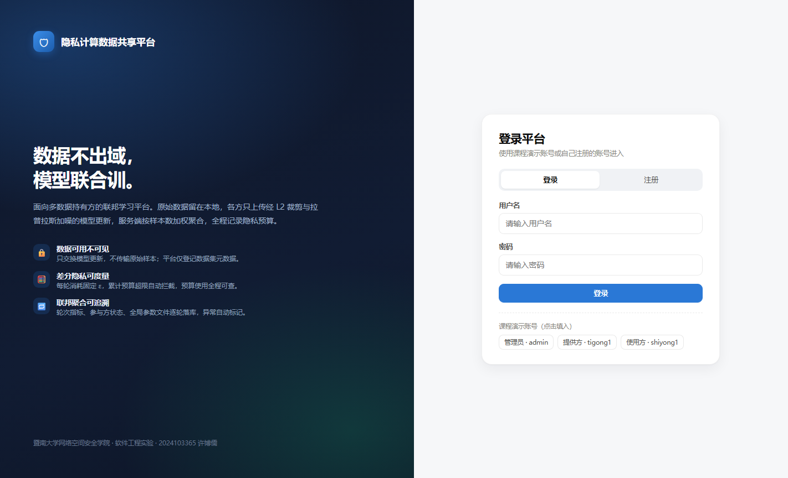
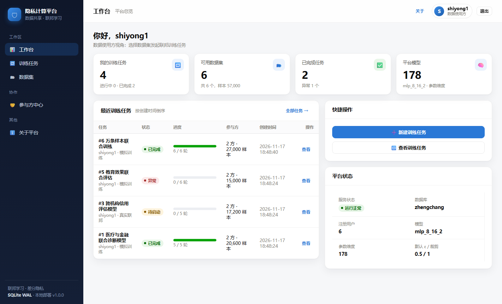
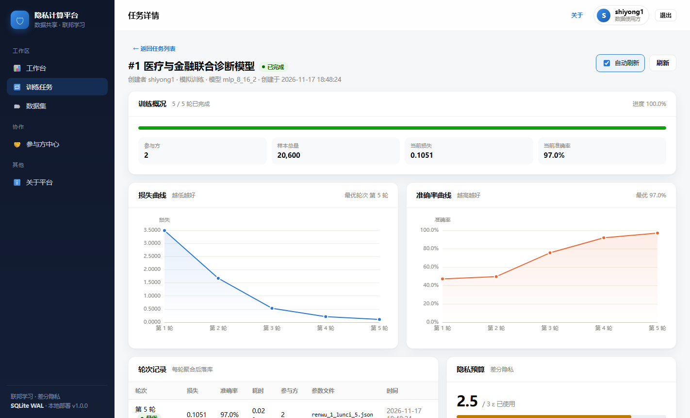
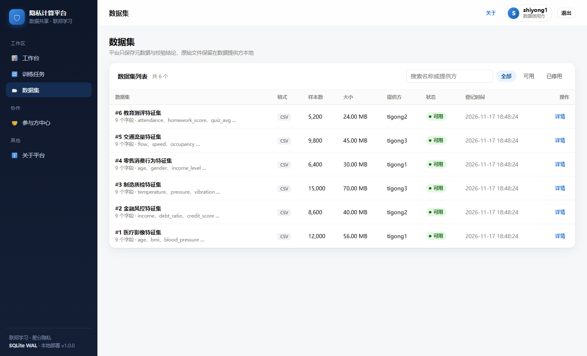
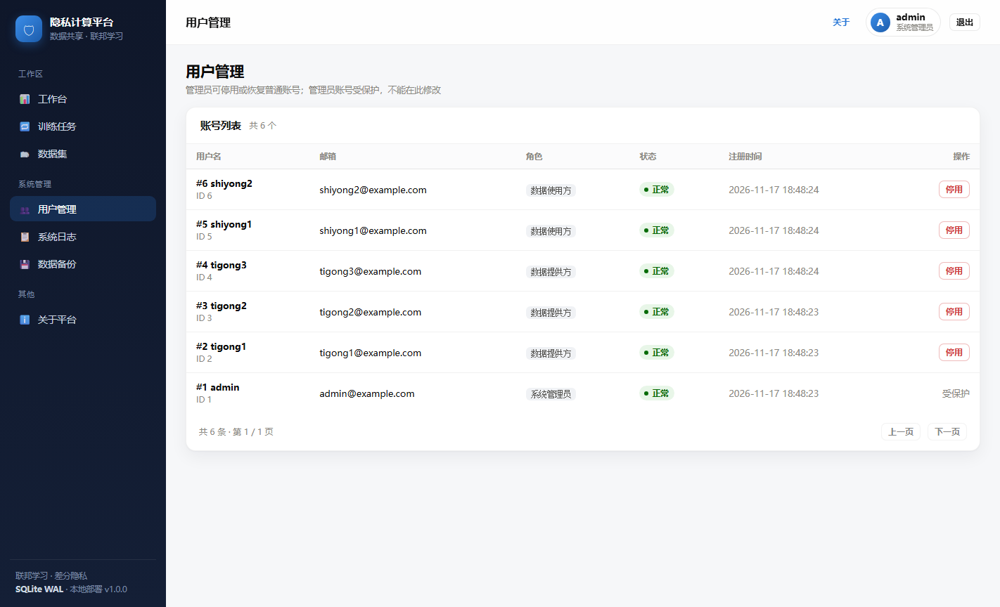
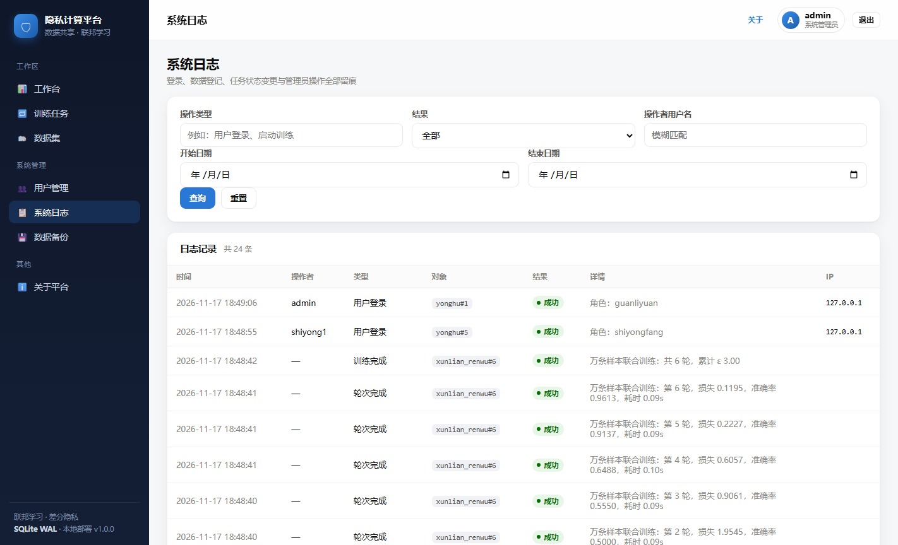

# 实验10：综合项目实战

## 一、实验目的

1. 把前九个实验的需求、设计、编码与测试成果整合成一个可运行的软件系统。
2. 完成平台的核心功能闭环：数据登记、联邦训练、隐私预算、结果展示与系统管理。
3. 按软件工程规范整理交付物，保证系统可安装、可运行、可演示、可追溯。
4. 掌握验收测试方法，用真实数据验证核心功能无重大缺陷。
5. 形成完整的项目总结，能够说明设计取舍、遇到的问题与改进方向。

## 二、实验环境

| 项目 | 内容 |
| --- | --- |
| 操作系统 | Windows 11 |
| 运行环境 | Python 3.13.17 |
| Web 框架 | FastAPI 0.162.2 + Uvicorn |
| 数据库 | SQLite 3（WAL 模式） |
| 前端 | Vue 3.5 + ECharts 5.6（本地副本，无需构建） |
| 模型 | NumPy 实现的 8-16-2 全连接网络（178 维参数） |
| 版本控制 | Git + GitHub |
| 课程项目 | 隐私计算数据共享平台（联邦学习 + 差分隐私） |

## 三、实验内容与步骤

### 3.1 项目概述

平台面向"多个数据持有方想联合训练模型，但不能交换原始数据"的场景。数据提供方只登记元数据，原始数据留在本地；数据使用方创建训练任务，平台在每轮训练后对模型更新做 L2 裁剪与拉普拉斯加噪，再按样本数加权聚合，并全程记录隐私预算。

系统由三层组成：

| 层次 | 技术 | 规模 |
| --- | --- | --- |
| 前端 | Vue 3 单页应用（哈希路由，无构建） | 10 个页面，约 2400 行 JS |
| 后端 | FastAPI 分层架构（routers → services → dao → SQLite） | 31 个 REST 接口，约 2590 行 Python |
| 训练 | NumPy MLP + 后台线程协调器 | 8-16-2 网络，178 维参数 |

### 3.2 交付物清单

| 交付物 | 位置 | 说明 |
| --- | --- | --- |
| 需求规格说明书 | Experiment2 | 3 类角色、17 项功能需求、13 项非功能需求 |
| UML 与概要设计 | Experiment3、Experiment4 | 用例图、系统结构图、模块依赖图、接口清单 |
| 详细设计 | Experiment5 | 类图、时序图、E-R 图与 3NF 分析 |
| 核心模块与编码规范 | Experiment6 | XunlianFuwu 模块与 8 个单元测试 |
| 版本控制记录 | Experiment7 | 分支策略、48 次提交、10 次合并、冲突解决 |
| 单元测试 | Experiment8、`Platform/tests/` | 86 个用例，语句覆盖率 86% |
| 集成测试与缺陷记录 | Experiment9、`Platform/docs/issues/` | 15 个场景，2 个缺陷及修复 |
| 可运行平台 | `Platform/` | 后端、前端、演示数据、README |
| 实验报告 | 本文档 | 全流程记录 |

### 3.3 核心功能实现

**（1）用户与权限**

系统有系统管理员、数据提供方、数据使用方三类角色。注册只开放提供方与使用方，管理员由系统初始化；登录使用 bcrypt 校验密码、JWT 签发令牌，接口层通过依赖注入统一校验登录态与角色。密码先做 SHA-256 再交给 bcrypt，规避 72 字节上限。

**（2）数据集管理**

提供方登记数据集时，平台只保存名称、格式、样本数、字段清单、脱敏规则与校验结论，不接收原始文件。登记前执行格式预检，字段名只能包含字母、数字和下划线；同名数据集会被拒绝。数据集可停用，正在被训练任务使用的数据集不允许停用。

**（3）联邦训练**

训练任务包含轮数、批大小、学习率、每轮 ε、L2 裁剪阈值与预算上限。启动后协调器在后台线程逐轮执行：

1. 检查累计 ε 是否超过预算上限；
2. 模拟模式自动产生各参与方更新，真实模式等待参与方提交；
3. 对更新做 L2 裁剪并加入拉普拉斯噪声；
4. 按服务端记录的样本数加权聚合；
5. 在固定基准集上评估，保存参数文件，写入轮次与预算记录。

**（4）结果展示**

任务详情页展示进度、当前损失与准确率、损失曲线、准确率曲线、轮次记录表和隐私预算面板。损失与准确率使用两张独立图表，避免共用坐标轴造成误读。训练进行中每 3 秒自动刷新。

**（5）系统管理**

管理员可以停用/恢复账号、强制取消或标记异常任务、按类型/结果/用户/日期筛选日志、创建并下载数据库备份。备份使用 SQLite 在线备份接口，保留最近 7 份。

### 3.4 界面验收

登录页左侧说明平台价值，右侧提供登录与注册切换，演示账号可一键填入。


图 10-1 登录页面

工作台按角色展示统计卡、最近任务、快捷操作与平台健康状态。演示数据包含 6 个数据集、57000 条样本和 5 个不同状态的任务。


图 10-2 工作台

任务详情页展示 5 轮训练的损失与准确率曲线。曲线前半段受差分隐私噪声影响增长较慢，第三轮后快速收敛，直观体现了隐私预算与模型效果之间的权衡。


图 10-3 任务详情与训练曲线

数据集页面展示每个数据集的样本数、大小、提供方、状态与校验结论，只展示元数据，不含原始样本。


图 10-4 数据集列表

管理员页面提供用户管理、系统日志与数据备份。日志记录登录、建任务、启动训练、轮次完成等操作，包含成功与失败结果、操作者与 IP。


图 10-5 用户管理


图 10-6 系统日志

### 3.5 验收测试

按照需求规格逐项验收，功能清单与结果如下：

| 编号 | 验收项 | 操作要点 | 结果 |
| --- | --- | --- | --- |
| A1 | 注册与登录 | 三角色登录、错误密码、停用账号 | 通过 |
| A2 | 角色权限 | 使用方登记数据集、非管理员访问管理接口 | 通过（403/4030） |
| A3 | 数据集登记 | 12000 条样本、字段校验、重名拒绝 | 通过 |
| A4 | 创建任务 | 选择两方数据集、配置轮数与隐私参数 | 通过 |
| A5 | 启动训练 | 后台执行、状态从待启动到已完成 | 通过 |
| A6 | 训练结果 | 曲线轮数、损失下降、准确率上升 | 通过 |
| A7 | 隐私预算 | 每轮 0.5、累计等于轮数乘 0.5、超限拦截 | 通过 |
| A8 | 真实模式 | 参与方领取参数、提交更新、轮次推进 | 通过 |
| A9 | 管理功能 | 停用账号、取消任务、日志筛选、备份下载 | 通过 |
| A10 | 前端页面 | 10 个页面可访问，无脚本异常 | 通过 |
| A11 | 异常处理 | 401/403/404/4005/4001 分支 | 通过 |
| A12 | 数据隔离 | 原始数据不出域，只登记元数据 | 通过 |

验收过程中未发现阻断性缺陷。单元测试 86 个用例、集成测试 15 个场景全部通过，语句覆盖率 86%。测试阶段发现的两个缺陷（样本截断、日志日期筛选）均已修复并回归。

### 3.6 性能与可靠性

| 指标 | 实测结果 | 说明 |
| --- | --- | --- |
| 服务启动 | 约 1 秒 | 建表、写入演示数据、标记中断任务 |
| 单轮模拟训练 | 0.04 至 0.5 秒 | 取决于样本数与批大小 |
| 27000 条样本、6 轮 | 2.72 秒 | 两方参与，模拟模式 |
| 接口响应 | 毫秒级 | 本地 SQLite，WAL 模式 |
| 数据库备份 | 约 139 KB | 在线备份，不阻塞读写 |
| 并发 | 单进程多线程 | 按任务加锁，避免重复启动 |

可靠性设计包括：每次数据库操作使用独立连接并设置 30 秒忙等；服务重启时把卡在训练中的任务标记为异常，参与方置为掉线；训练线程有兜底异常处理，任何异常都会落到任务状态而不是静默失败；隐私预算在每轮开始前检查，超限立即终止。

### 3.7 运行与部署

```bash
cd Platform
pip install -r requirements.txt
python main.py
```

浏览器访问 `http://127.0.0.1:8000/`，接口文档在 `/docs`。演示账号：

| 用户名 | 密码 | 角色 |
| --- | --- | --- |
| admin | admin123 | 系统管理员 |
| tigong1 / tigong2 / tigong3 | 123456 | 数据提供方 |
| shiyong1 / shiyong2 | 123456 | 数据使用方 |

可通过 `PINGTAI_SHUJU` 指定独立数据目录，便于测试与演示隔离。演示数据升级时自动备份旧库，不需要手工删库。

### 3.8 课堂演示脚本

1. 打开登录页，说明平台解决"数据不出域"的问题（1 分钟）。
2. 用 shiyong1 登录，展示工作台统计（1 分钟）。
3. 新建任务：选择两个数据集、4 至 6 轮、ε=0.5、模拟模式（2 分钟）。
4. 启动训练，进入任务详情查看曲线与隐私预算（2 分钟）。
5. 登录 tigong1，进入参与方中心，说明真实模式的领取与提交（2 分钟）。
6. 登录 admin，查看系统日志与备份（1 分钟）。
7. 打开"关于平台"，说明差分隐私公式与加权聚合（1 分钟）。

### 3.9 项目总结

**完成的闭环**

项目从需求分析开始，经过 UML 建模、概要设计、详细设计、编码规范、版本控制、单元测试、集成测试，最终形成可运行平台。每个阶段的产出都能在后续阶段找到落点：需求对应接口与权限规则，类图对应服务与 DAO，时序图对应训练协调器，测试用例对应错误码与边界条件。

**设计取舍**

1. 用 NumPy 手写 MLP 而不是引入 PyTorch：课程环境要求轻量、可离线运行，178 维参数足以演示联邦聚合与差分隐私，同时避免大依赖。
2. 前端使用无构建 Vue：不需要 Node 工具链，浏览器直接加载本地副本，部署只需一个 Python 进程。
3. 模拟模式与真实模式并存：模拟模式用于快速演示与验收，真实模式保留参与方交互，体现联邦学习的协作本质。
4. 演示数据采用"千条样本起步"：数据集规模与训练实际使用的样本一致，避免"登记一万条、训练一千条"的失真。

**遇到的问题**

1. 差分隐私噪声会显著拖慢收敛。ε=0.5 时前两轮准确率几乎不变，第三轮后才快速上升。解决办法是把演示任务的轮数设为 5 轮以上，并在报告中说明这是隐私保护的正常代价。
2. 样本数上限写死导致训练与登记不一致，通过集成验证发现并修复。
3. 日志日期筛选的字符串比较漏掉当天记录，通过单元测试暴露并修复。
4. 演示数据过少会让界面像玩具，后来扩充为 6 个数据集、57000 条样本、5 个状态齐全的任务。

**改进方向**

1. 支持多个任务并发训练，当前协调器按任务加锁，尚未做全局调度。
2. 增加模型版本管理与参数文件下载，便于离线复现。
3. 引入更严格的隐私会计（RDP 或 Moments Accountant），替代当前的简单累计。
4. 增加浏览器端自动化测试，覆盖表单交互与图表渲染。
5. 接入 GitHub Actions，提交时自动运行单元测试与覆盖率检查。

## 四、实验小结

综合项目实战把前九个实验串成了一条完整链路：需求决定接口，设计决定分层，编码规范保证可维护，版本控制保证可追溯，测试保证可交付。平台能够真实完成"多方数据不出域、联合训练模型、隐私预算可查"的演示，核心功能通过验收，缺陷有记录、有修复、有回归。

最大的体会是：软件工程的价值不在于画出多少图，而在于每个阶段的产出都能被下一阶段使用，并且在出问题时能沿着记录快速定位。需求、设计、代码、测试、提交历史互相对应，项目才算真正完成。
