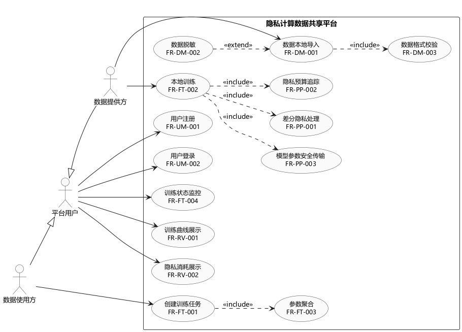
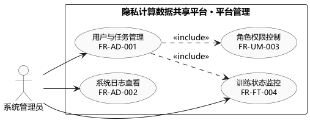

# 实验3：UML 建模

## 一、实验目的

1. 掌握面向对象分析的基本方法，理解用例图在需求分析中的作用。
2. 学会使用 UML 建模工具绘制用例图，掌握参与者、用例、关联、包含、扩展和泛化等元素的使用方法。
3. 基于实验2的《软件需求规格说明书》，把 17 项功能需求转换为用例模型，检查需求是否覆盖完整。
4. 对系统核心模块编写用例描述，说明用例的参与者、前置条件、基本流和异常流。

## 二、实验环境

| 项目 | 内容 |
| --- | --- |
| 操作系统 | Windows 11 |
| 运行环境 | OpenJDK 17.0.20.1 |
| 建模工具 | PlantUML 1.2024.7（plantuml.jar，Maven Central 下载） |
| 图形布局 | PlantUML 内置布局引擎；Graphviz 16.1.0 用于后续实验的架构图 |
| 编辑方式 | 编写 `.puml` 源文件，命令行调用 PlantUML 渲染 PNG/SVG |
| 项目 | 隐私计算数据共享平台（联邦学习 + 差分隐私） |

建模源文件位于 `Experiment3/uml/`，图片同时输出 PNG 和 SVG 两种格式，SVG 用于报告排版时保持清晰。

## 三、实验内容与步骤

### 3.1 UML 建模软件的选择与安装

本实验选用 PlantUML 作为建模工具。PlantUML 使用文本描述 UML 图，图形由工具自动排版，便于版本管理和反复修改。

安装过程：

1. 从 Maven Central 下载 `plantuml-1.2024.7.jar`；
2. 使用 `winget install Graphviz.Graphviz` 安装 Graphviz 16.1.0（本实验的用例图由 PlantUML 内置布局引擎排版，Graphviz 在实验4绘制架构图时使用）；
3. 使用以下命令渲染图片：

```bash
java -jar plantuml.jar -charset UTF-8 -tpng yonglitu_1_hexin_yewu.puml
java -jar plantuml.jar -charset UTF-8 -tsvg yonglitu_1_hexin_yewu.puml
```

### 3.2 用例图元素与建模约定

| 元素 | 图形 | 本实验约定 |
| --- | --- | --- |
| 参与者 Actor | 火柴人 | 系统外部与系统交互的人或角色，本系统有数据提供方、数据使用方、系统管理员 |
| 用例 Use Case | 椭圆 | 系统向参与者提供的一项完整功能，名称与需求编号对应 |
| 关联 Association | 实线箭头 | 参与者与用例之间的使用关系，箭头指向用例 |
| 包含 Include | 虚线箭头 <<include>> | 基础用例执行时必须执行被包含用例 |
| 扩展 Extend | 虚线箭头 <<extend>> | 在特定条件下才执行的可选行为 |
| 泛化 Generalization | 空心三角箭头 | 子参与者继承父参与者的用例 |

用例名称下方标注对应的需求编号（如 FR-DM-001），便于和实验2的 SRS 逐项对照。

### 3.3 参与者与用例识别

从实验2的需求规格说明书出发，系统的参与者如下：

| 参与者 | 类型 | 主要职责 |
| --- | --- | --- |
| 数据提供方 | 业务参与者 | 在本地导入数据、参与联邦训练、查看本机相关结果 |
| 数据使用方 | 业务参与者 | 创建联邦训练任务、查看训练状态与结果 |
| 系统管理员 | 业务参与者 | 管理用户与任务、查看系统日志 |
| 平台用户 | 抽象参与者 | 数据提供方和数据使用方的公共父角色，负责注册登录、状态查看和结果查看 |

说明：数据提供方和数据使用方都需要注册、登录、查看训练状态和结果。如果分别连线，用例图会出现大量重复且交叉的关联线，因此抽取抽象参与者“平台用户”，两个业务角色通过泛化继承它的用例，图中只保留各自特有的用例关联。

用例识别结果与需求编号的对应关系见 3.6 节的需求覆盖表。

### 3.4 用例图 1：核心业务用例图



参与者：数据提供方、数据使用方、平台用户（抽象）。

主要用例与关系：

| 用例 | 参与者 | 关系 | 对应需求 |
| --- | --- | --- | --- |
| 用户注册 | 平台用户 | 关联 | FR-UM-001 |
| 用户登录 | 平台用户 | 关联 | FR-UM-002 |
| 数据本地导入 | 数据提供方 | 关联；被数据脱敏扩展 | FR-DM-001 |
| 数据脱敏 | 数据提供方 | <<extend>> 数据本地导入 | FR-DM-002 |
| 数据格式校验 | — | 被数据本地导入包含 | FR-DM-003 |
| 创建训练任务 | 数据使用方 | 关联；包含参数聚合 | FR-FT-001 |
| 本地训练 | 数据提供方 | 关联；包含差分隐私处理、隐私预算追踪、模型参数安全传输 | FR-FT-002 |
| 参数聚合 | — | 被创建训练任务包含 | FR-FT-003 |
| 训练状态监控 | 平台用户 | 关联 | FR-FT-004 |
| 差分隐私处理 | — | 被本地训练包含 | FR-PP-001 |
| 隐私预算追踪 | — | 被本地训练包含 | FR-PP-002 |
| 模型参数安全传输 | — | 被本地训练包含 | FR-PP-003 |
| 训练曲线展示 | 平台用户 | 关联 | FR-RV-001 |
| 隐私消耗展示 | 平台用户 | 关联 | FR-RV-002 |

关系说明：

- 数据格式校验是数据导入的必要步骤，因此用 <<include>> 从“数据本地导入”指向“数据格式校验”。
- 数据脱敏是可选操作，只在数据包含敏感字段时执行，因此用 <<extend>> 从“数据脱敏”指向“数据本地导入”。
- 本地训练前必须先对模型更新做差分隐私处理并记录隐私预算，模型更新上传时必须走安全传输通道，因此这三项作为“本地训练”的包含用例。
- 参数聚合发生在训练任务执行过程中，由创建任务触发，因此作为“创建训练任务”的包含用例。

### 3.5 用例图 2：平台管理用例图



参与者：系统管理员。

| 用例 | 参与者 | 关系 | 对应需求 |
| --- | --- | --- | --- |
| 用户与任务管理 | 系统管理员 | 关联；包含角色权限控制、训练状态监控 | FR-AD-001 |
| 系统日志查看 | 系统管理员 | 关联 | FR-AD-002 |
| 角色权限控制 | — | 被用户与任务管理包含 | FR-UM-003 |
| 训练状态监控 | 系统管理员 | 关联；被用户与任务管理包含 | FR-FT-004 |

说明：管理员不接触参与方的本地原始数据，管理用例的范围限定在用户、任务状态和系统日志，与 SRS 中 FR-AD-001 的异常约束保持一致。

### 3.6 核心用例描述

#### UC-01 数据本地导入

| 项目 | 内容 |
| --- | --- |
| 用例编号 | UC-01 |
| 用例名称 | 数据本地导入 |
| 参与者 | 数据提供方 |
| 目标 | 在不向平台上传原始数据的前提下，把本地数据集登记到平台 |
| 前置条件 | 用户已登录，角色为数据提供方；本地存在待导入的数据文件 |
| 触发条件 | 用户在数据集管理页点击“导入数据集” |
| 基本事件流 | 1. 用户选择本地 CSV/JSON 文件并填写数据集名称；<br>2. 客户端读取文件，调用数据格式校验（UC-05）；<br>3. 如数据含敏感字段，可选择执行数据脱敏（UC-04）；<br>4. 客户端提取文件名、格式、大小、字段列表等元信息；<br>5. 把元信息提交到服务端，原始文件保留在本地；<br>6. 服务端保存元信息并返回数据集编号。 |
| 备选事件流 | 2a. 文件无法读取：提示文件损坏或权限不足，流程结束；<br>2b. 格式校验不通过：显示具体错误字段，不允许登记；<br>3a. 用户放弃脱敏：直接进入第 4 步；<br>5a. 同名数据集已存在：提示用户修改名称或覆盖登记。 |
| 后置条件 | 数据集中出现一条“可用”状态的元信息记录；原始数据文件仍在数据提供方本地 |
| 关联需求 | FR-DM-001、FR-DM-002、FR-DM-003、NFR-SEC-001 |

#### UC-02 创建训练任务

| 项目 | 内容 |
| --- | --- |
| 用例编号 | UC-02 |
| 用例名称 | 创建训练任务 |
| 参与者 | 数据使用方 |
| 目标 | 创建一个联邦训练任务，指定模型、参与方、训练轮次和隐私配置 |
| 前置条件 | 用户已登录且角色为数据使用方；平台存在可参与训练的数据提供方 |
| 触发条件 | 用户在训练任务页点击“新建任务” |
| 基本事件流 | 1. 用户填写任务名称，选择模型类型、参与方列表、训练轮次和隐私预算；<br>2. 服务端校验必填项、轮次范围和参与者权限；<br>3. 服务端生成任务编号，保存任务信息，状态置为“等待参与方”；<br>4. 参与方确认后进入训练流程，服务端调用参数聚合（UC-08）；<br>5. 返回任务编号和创建结果。 |
| 备选事件流 | 2a. 参与方为空或训练轮次不合法：提示修改；<br>2b. 隐私预算参数非法：提示取值范围；<br>4a. 确认参与的参与方数量不足：任务标记为失败并记录原因。 |
| 后置条件 | 训练任务已创建并可被监控；后续轮次的训练状态写入任务记录 |
| 关联需求 | FR-FT-001、FR-FT-003、FR-FT-004、FR-PP-002 |

#### UC-03 本地训练

| 项目 | 内容 |
| --- | --- |
| 用例编号 | UC-03 |
| 用例名称 | 本地训练 |
| 参与者 | 数据提供方 |
| 目标 | 在本地数据上完成一轮训练，并上传经过差分隐私处理的模型更新 |
| 前置条件 | 训练任务已启动；本地数据集可用；已收到服务端下发的全局模型 |
| 触发条件 | 服务端下发本轮训练配置 |
| 基本事件流 | 1. 参与方客户端接收全局模型参数和训练配置；<br>2. 使用 PyTorch 在本地数据上训练，得到本地模型更新和损失值；<br>3. 调用差分隐私处理（UC-10）：按裁剪阈值裁剪更新，再加入拉普拉斯噪声；<br>4. 调用隐私预算追踪（UC-11）：记录本轮消耗并累计；<br>5. 通过 HTTPS/TLS 安全传输（UC-12）把加噪后的更新上传到服务端；<br>6. 上报本轮训练指标。 |
| 备选事件流 | 2a. 本地数据不可用或训练异常：记录失败原因并上报任务状态；<br>4a. 累计隐私预算超过上限：停止本轮训练并提示；<br>5a. 传输失败：本轮状态不能标记为成功，等待重试或任务失败。 |
| 后置条件 | 服务端收到本轮模型更新；隐私日志新增一条记录；训练指标写入任务记录 |
| 关联需求 | FR-FT-002、FR-PP-001、FR-PP-002、FR-PP-003 |

#### UC-04 训练状态监控

| 项目 | 内容 |
| --- | --- |
| 用例编号 | UC-04 |
| 用例名称 | 训练状态监控 |
| 参与者 | 平台用户、系统管理员 |
| 目标 | 查看训练任务当前轮次、参与方状态和训练指标 |
| 前置条件 | 用户已登录；任务存在且用户对任务有查看权限 |
| 触发条件 | 用户在任务列表点击某个任务，或前端定时轮询状态接口 |
| 基本事件流 | 1. 前端按任务编号请求状态；<br>2. 服务端检查用户身份和任务权限；<br>3. 返回当前轮次、任务状态、参与方状态、损失值和准确率；<br>4. 前端刷新进度展示。 |
| 备选事件流 | 2a. 任务不存在：返回“任务不存在”；<br>2b. 用户无权限：返回无权限提示，不返回任务详情；<br>3a. 某轮指标缺失：返回已有数据并标注缺失轮次。 |
| 后置条件 | 无数据变更，仅完成查询 |
| 关联需求 | FR-FT-004、NFR-PERF-001 |

#### 其他用例说明

| 用例 | 简要描述 | 对应需求 |
| --- | --- | --- |
| 训练曲线展示 | 按轮次展示损失曲线和准确率曲线，指标缺失时注明 | FR-RV-001 |
| 隐私消耗展示 | 按轮次汇总隐私预算消耗，未启用差分隐私的任务显示“未启用” | FR-RV-002 |
| 用户与任务管理 | 管理员查询用户和任务列表，处理异常账号与任务 | FR-AD-001 |
| 系统日志查看 | 按时间、用户、操作类型查询登录、任务和管理操作日志 | FR-AD-002 |

### 3.7 需求覆盖检查

| 需求编号 | 需求名称 | 所属用例图 | 用例 |
| --- | --- | --- | --- |
| FR-UM-001 | 用户注册 | 图 1 | 用户注册 |
| FR-UM-002 | 用户登录 | 图 1 | 用户登录 |
| FR-UM-003 | 角色权限控制 | 图 2 | 角色权限控制 |
| FR-DM-001 | 数据本地导入 | 图 1 | 数据本地导入 |
| FR-DM-002 | 数据脱敏 | 图 1 | 数据脱敏 |
| FR-DM-003 | 数据格式校验 | 图 1 | 数据格式校验 |
| FR-FT-001 | 创建训练任务 | 图 1 | 创建训练任务 |
| FR-FT-002 | 本地训练 | 图 1 | 本地训练 |
| FR-FT-003 | 参数聚合 | 图 1 | 参数聚合 |
| FR-FT-004 | 训练状态监控 | 图 1、图 2 | 训练状态监控 |
| FR-PP-001 | 差分隐私处理 | 图 1 | 差分隐私处理 |
| FR-PP-002 | 隐私预算追踪 | 图 1 | 隐私预算追踪 |
| FR-PP-003 | 模型参数安全传输 | 图 1 | 模型参数安全传输 |
| FR-RV-001 | 训练曲线展示 | 图 1 | 训练曲线展示 |
| FR-RV-002 | 隐私消耗展示 | 图 1 | 隐私消耗展示 |
| FR-AD-001 | 用户与任务管理 | 图 2 | 用户与任务管理 |
| FR-AD-002 | 系统日志查看 | 图 2 | 系统日志查看 |

17 项功能需求全部映射到用例，没有遗漏；用例图中没有出现 SRS 之外的功能。

## 四、实验结果

1. 完成了两张用例图：核心业务用例图（图 1）和平台管理用例图（图 2），均包含参与者、用例和关联、包含、扩展、泛化关系。
2. 完成了 4 个核心用例的详细描述，覆盖数据导入、任务创建、本地训练和状态监控四个关键环节。
3. 建立了需求与用例的追踪表，17 项功能需求全部覆盖。
4. 建模源文件（`.puml`）和导出图片（`.png`、`.svg`）已放入仓库 `Experiment3/uml/`。

## 五、实验总结与心得

### 5.1 遇到的问题与解决

（1）用例粒度过细。最初把“数据格式校验”画成独立用例并直接连到数据提供方，导致一个导入动作被拆成两个平级用例。后来改为“数据本地导入”包含“数据格式校验”，更符合 include 的含义：校验是导入过程中必须执行的一步，而不是参与者单独发起的功能。

（2）include 和 extend 容易混用。数据脱敏是可选操作，只在数据含敏感字段时执行，应该用 extend；一开始写成了 include，会把脱敏变成每次导入都必须执行，与需求不符。判断依据是：必须执行的用 include，条件触发的用 extend。

（3）用例图连线交叉严重。数据提供方和数据使用方都要注册登录、查看状态和结果，直接连线的结果是一大把交叉线。抽出抽象参与者“平台用户”后，公共用例只连一次，两个业务角色用泛化继承，图面清楚了很多。

（4）图形布局问题。先尝试按模块把用例放进包里，结果包与包之间位置被拉得很散，连线绕来绕去。改成平铺用例、用参与者泛化减少关联之后，布局明显改善。这说明用例图主要表达参与者与功能的关系，模块划分可以放到概要设计里表达。

（5）术语要与 SRS 保持一致。旧图里写的是“模型参数加密上传”，但实验2已经把需求改成“模型参数安全传输”（只要求 HTTPS/TLS，不承诺密码学安全聚合），本次统一改为 SRS 中的名称，避免文档前后矛盾。

### 5.2 收获

（1）用例图不是把功能列表画成椭圆就行。参与者是谁、用例的边界在哪里、哪些步骤应该被包含，都会影响后续设计和测试的理解。

（2）需求编号和用例一一对应之后，写用例描述和后面的测试用例都能直接引用编号，比用自然语言描述准确。

（3）PlantUML 用文本管理图形，修改一个名字只需要改一行源文件，重新渲染即可，比手工拖拽图形更适合需要反复迭代的课程项目。

### 5.3 对后续实验的准备

实验4将在本实验的基础上做系统概要设计：把用例图中的功能分配到模块，确定三层架构和模块之间的依赖关系，并定义模块接口。用例描述中的基本事件流会作为设计接口和后续测试用例的输入。
