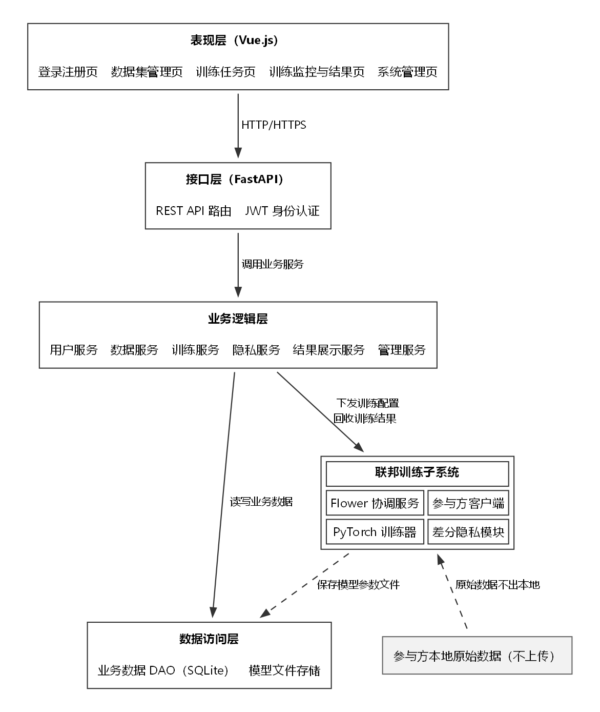
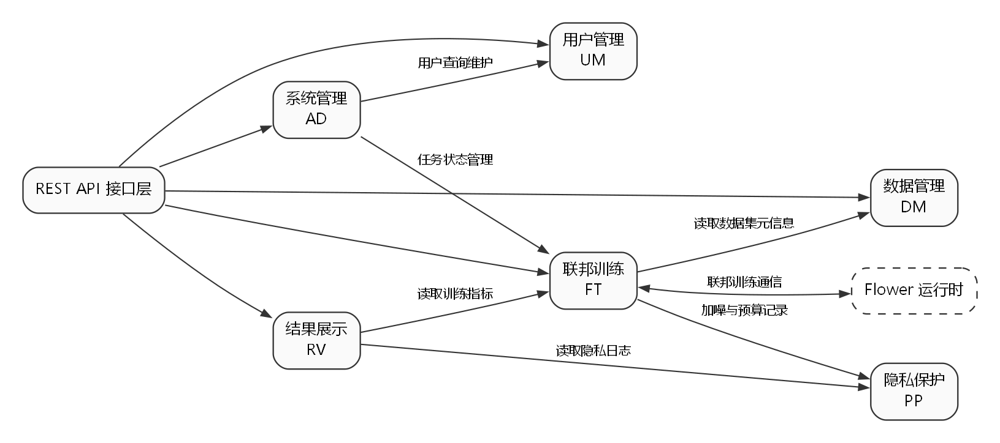

# 实验4：系统概要设计

## 一、实验目的

1. 掌握软件概要设计的基本方法，能够从需求规格说明导出系统架构。
2. 学会按高内聚、低耦合的原则划分功能模块，明确模块职责和模块边界。
3. 能够绘制系统结构图和模块依赖图，说明系统的分层结构和依赖方向。
4. 能够定义模块之间的接口，包括前端与后端的 REST 接口、后端模块之间的内部接口以及联邦训练通信接口。

## 二、实验环境

| 项目 | 内容 |
| --- | --- |
| 操作系统 | Windows 11 |
| 建模工具 | Graphviz 16.1.0（dot 布局，绘制系统结构图和模块依赖图） |
| 后端技术 | Python 3.9+、FastAPI、SQLite |
| 联邦学习 | Flower、PyTorch |
| 前端技术 | Vue.js |

## 三、实验内容与步骤

### 3.1 设计目标与原则

概要设计以实验2的 SRS 和实验3的用例模型为输入，解决“系统由哪些部分组成、各部分如何协作”的问题。设计遵循以下原则：

1. **需求驱动**：每个模块都能追溯到具体需求编号，不设计 SRS 之外的功能。
2. **分层设计**：采用表现层、接口层、业务逻辑层、数据访问层四层结构，上层只能调用下层，禁止跨层反向依赖。
3. **高内聚**：把联系紧密、服务于同一业务目标的功能放在同一个模块内，例如差分隐私加噪和隐私预算记录都属于隐私保护。
4. **低耦合**：模块之间只通过明确定义的接口通信，不直接访问对方的内部数据表或内部变量。
5. **安全约束优先**：原始训练数据只保存在数据提供方本地，服务端只保存元信息、任务状态、模型参数和日志。
6. **可扩展**：新增模型类型或参与方时，不改动已有的任务数据和模块接口。

### 3.2 系统总体架构

系统采用 B/S 结构，整体为“四层 + 一个联邦训练子系统”：

- **表现层**：Vue.js 单页应用，负责页面展示和用户交互，不包含业务规则。
- **接口层**：FastAPI 提供 REST API，负责请求解析、参数校验、JWT 身份认证和统一响应封装。
- **业务逻辑层**：按业务划分六个服务模块，实现需求中的业务规则。
- **数据访问层**：封装 SQLite 访问和模型参数文件存储，向上提供数据访问接口。
- **联邦训练子系统**：Flower 协调服务、参与方客户端、PyTorch 训练器和差分隐私模块，负责实际的联邦训练过程。

系统结构如图 4-1 所示。



图 4-1 系统结构图

一次完整的调用过程：

1. 用户在浏览器操作页面，前端通过 HTTP/HTTPS 调用后端 REST API；
2. 接口层完成身份认证和参数校验后，调用对应的业务服务；
3. 业务服务通过数据访问层读写 SQLite 中的业务数据；
4. 训练服务把训练配置交给 Flower 协调服务，协调服务与各参与方客户端交换模型参数；
5. 参与方客户端在本地数据上训练，调用差分隐私模块对模型更新加噪，再把更新上传；
6. 协调服务完成聚合后，训练服务把全局模型参数交给数据访问层保存，并把指标写入任务记录。

### 3.3 核心模块划分

根据 SRS 的功能分类，把业务逻辑层划分为六个模块：

| 模块 | 编号 | 主要职责 | 包含功能 | 对应需求 |
| --- | --- | --- | --- | --- |
| 用户管理 | UM | 账号、登录状态和角色权限 | 注册、登录、JWT 签发与校验、角色权限判断 | FR-UM-001～003 |
| 数据管理 | DM | 数据集元信息和本地数据预处理 | 本地导入登记、格式校验、脱敏规则处理 | FR-DM-001～003 |
| 联邦训练 | FT | 训练任务的生命周期和训练协调 | 创建任务、启动训练、本地训练协调、参数聚合、状态监控 | FR-FT-001～004 |
| 隐私保护 | PP | 差分隐私和隐私预算 | 梯度裁剪与加噪、隐私预算记录、模型参数安全传输配置 | FR-PP-001～003 |
| 结果展示 | RV | 训练结果的查询和整理 | 训练曲线数据、隐私消耗数据 | FR-RV-001～002 |
| 系统管理 | AD | 平台级管理功能 | 用户与任务管理、系统日志查询 | FR-AD-001～002 |

模块划分说明：

- **用户管理**只处理身份和权限，不处理业务数据。其他模块通过接口层拿到的当前用户信息做权限判断，不重复实现登录逻辑。
- **数据管理**只保存数据集的元信息，不保存原始数据文件。脱敏在参与方本地执行，模块只提供规则和结果登记接口。
- **联邦训练**是系统的核心模块，负责任务编排和与 Flower 的交互，但不实现差分隐私算法本身，算法交给隐私保护模块。
- **隐私保护**独立成一个模块，原因是差分隐私参数和预算记录会同时被训练模块和结果展示模块使用，独立后可以避免算法逻辑散落在多个模块。
- **结果展示**只做查询和整理，不修改任务状态，属于只读模块。
- **系统管理**面向管理员，依赖用户管理和联邦训练提供的查询接口，不直接操作业务表。

### 3.4 模块依赖关系

模块依赖关系如图 4-2 所示。



图 4-2 模块依赖图

依赖规则：

| 调用方 | 被调用方 | 依赖内容 | 说明 |
| --- | --- | --- | --- |
| 表现层 | 接口层 | REST API | 前端只通过接口访问系统，不直接访问数据库 |
| 接口层 | 六个业务模块 | 业务服务接口 | 接口层只做协议转换、认证和参数校验 |
| 业务模块 | 数据访问层 | DAO 接口 | 业务模块不直接写 SQL |
| 联邦训练 FT | 数据管理 DM | 数据集元信息查询 | 创建任务时检查参与方数据集是否可用 |
| 联邦训练 FT | 隐私保护 PP | 加噪、预算检查与记录 | 训练模块不实现差分隐私算法 |
| 结果展示 RV | 联邦训练 FT | 训练指标查询 | 只读，不改变任务状态 |
| 结果展示 RV | 隐私保护 PP | 隐私日志查询 | 只读，不改变预算记录 |
| 系统管理 AD | 用户管理 UM | 用户查询与状态维护 | 管理员操作通过用户管理接口执行 |
| 系统管理 AD | 联邦训练 FT | 任务状态查询与异常处理 | 管理员不直接修改训练数据 |
| 联邦训练 FT | Flower 运行时 | 训练配置与模型参数 | 通过网络接口通信，不属于进程内依赖 |

依赖关系检查：

1. 没有循环依赖。FT 依赖 DM 和 PP，RV 依赖 FT 和 PP，AD 依赖 UM 和 FT，依赖方向都是从业务上层指向业务下层或同层的只读服务，没有反向调用。
2. 没有跨层依赖。表现层不访问数据访问层，接口层不直接操作 DAO，业务模块不直接拼接 SQL。
3. 公共的日志写入不放在系统管理模块中，而是由接口层的统一日志组件记录，系统管理模块只负责查询日志。这样其他模块不需要为了写日志而依赖 AD，避免了 AD 与所有模块之间的双向依赖。
4. 隐私保护模块不依赖联邦训练模块，只接收“模型更新、隐私参数”这样的输入，因此可以被训练模块和测试程序单独调用，耦合度低。

### 3.5 模块接口定义

#### 3.5.1 前端与后端之间的 REST 接口

接口统一使用 JSON，路径以 `/api` 开头，受保护接口需要在请求头携带 `Authorization: Bearer <token>`。

| 编号 | 方法 | 路径 | 功能 | 输入 | 输出 | 可访问角色 | 对应需求 |
| --- | --- | --- | --- | --- | --- | --- | --- |
| API-UM-01 | POST | /api/auth/register | 用户注册 | 用户名、密码、邮箱、角色 | 用户编号、创建结果 | 公开 | FR-UM-001 |
| API-UM-02 | POST | /api/auth/login | 用户登录 | 用户名、密码 | JWT Token、角色 | 公开 | FR-UM-002 |
| API-UM-03 | GET | /api/auth/me | 查询当前用户 | Token | 用户信息、权限列表 | 全部用户 | FR-UM-003 |
| API-DM-01 | POST | /api/datasets | 登记数据集元信息 | 名称、格式、大小、本地引用 | 数据集编号 | 数据提供方 | FR-DM-001 |
| API-DM-02 | POST | /api/datasets/check | 提交格式校验结果 | 字段列表、样本统计 | 校验结论、错误字段 | 数据提供方 | FR-DM-003 |
| API-FT-01 | POST | /api/tasks | 创建训练任务 | 名称、模型类型、轮次、参与方、隐私配置 | 任务编号 | 数据使用方 | FR-FT-001 |
| API-FT-02 | POST | /api/tasks/{id}/start | 启动任务 | 任务编号 | 任务状态 | 数据使用方 | FR-FT-001、FR-FT-003 |
| API-FT-03 | GET | /api/tasks/{id} | 查询任务状态 | 任务编号 | 轮次、状态、参与方状态、指标 | 有权限用户 | FR-FT-004 |
| API-RV-01 | GET | /api/tasks/{id}/curves | 查询训练曲线 | 任务编号 | 每轮损失、准确率 | 有权限用户 | FR-RV-001 |
| API-RV-02 | GET | /api/tasks/{id}/privacy | 查询隐私消耗 | 任务编号 | 每轮消耗、累计值、剩余预算 | 有权限用户 | FR-RV-002 |
| API-AD-01 | GET | /api/admin/users | 查询用户列表 | 分页、关键字 | 用户列表 | 系统管理员 | FR-AD-001 |
| API-AD-02 | PATCH | /api/admin/tasks/{id} | 处理异常任务 | 任务编号、目标状态、原因 | 处理结果 | 系统管理员 | FR-AD-001 |
| API-AD-03 | GET | /api/admin/logs | 查询系统日志 | 时间范围、用户、操作类型、分页 | 日志列表 | 系统管理员 | FR-AD-002 |

统一响应格式：

```json
{
  "code": 0,
  "message": "ok",
  "data": {}
}
```

错误码约定：参数错误返回 400，未登录返回 401，无权限返回 403，资源不存在返回 404，冲突返回 409，服务器异常返回 500。日志中不记录密码、Token 和原始训练数据。

#### 3.5.2 业务模块内部接口

业务模块之间通过函数级接口调用，函数名统一使用汉语拼音，输入输出使用数据对象或字典，不直接传递数据库连接。

| 接口名 | 所属模块 | 输入 | 输出 | 说明 |
| --- | --- | --- | --- | --- |
| `zhuce_yonghu` | UM | 用户名、密码、邮箱、角色 | 用户编号 | 校验重名，密码哈希后保存 |
| `denglu_yonghu` | UM | 用户名、密码 | Token、角色 | 校验密码并签发 JWT |
| `jiancha_quanxian` | UM | 用户编号、功能编号 | 是否允许 | 按角色判断功能权限 |
| `dengji_shujuji` | DM | 用户编号、名称、格式、大小、本地引用 | 数据集编号 | 只登记元信息，不接收原始文件 |
| `jiaoyan_geshi` | DM | 字段列表、样本统计 | 校验结论、错误字段 | 在客户端完成，服务端只接收结论 |
| `tuomin_ziduan` | DM | 记录列表、脱敏规则 | 脱敏后的记录 | 在参与方本地执行 |
| `chuangjian_renwu` | FT | 发起人编号、任务参数 | 任务编号 | 校验参数后保存任务 |
| `qidong_xunlian` | FT | 任务编号 | 任务状态 | 通知 Flower 开始训练 |
| `juhe_canshu` | FT | 任务编号、各参与方更新 | 全局模型参数 | 按样本数加权平均 |
| `chaxun_zhuangtai` | FT | 任务编号 | 轮次、状态、指标 | 供接口层和结果展示调用 |
| `jiazao_gengxin` | PP | 模型更新、隐私预算、裁剪阈值 | 加噪后的更新 | 先裁剪再加拉普拉斯噪声 |
| `jilu_yusuan` | PP | 任务编号、轮次、本轮消耗 | 累计消耗、剩余预算 | 写入隐私日志 |
| `jiancha_yusuan` | PP | 任务编号、本轮预算 | 是否允许继续 | 超过上限时停止训练 |
| `chaxun_quxian` | RV | 任务编号 | 每轮损失、准确率 | 只读查询 |
| `chaxun_yinhao` | RV | 任务编号 | 每轮隐私消耗 | 只读查询 |
| `liechu_yonghu` | AD | 分页、关键字 | 用户列表 | 管理员查询 |
| `liechu_renwu` | AD | 分页、状态 | 任务列表 | 管理员查询 |
| `chaxun_rizhi` | AD | 时间、用户、操作类型 | 日志列表 | 只读查询 |

接口约束：

1. 跨模块调用只允许调用上表列出的接口，不允许直接访问对方的数据库表。
2. 隐私保护模块的接口是纯函数式调用，不依赖当前登录用户，方便单元测试。
3. 所有写操作返回结果对象，包含成功标志和失败原因，不通过抛出未捕获异常的方式传递错误。

#### 3.5.3 联邦训练通信接口

| 方向 | 内容 | 说明 |
| --- | --- | --- |
| 服务端 → 参与方 | 全局模型参数、轮次、训练配置（批大小、学习率、本地轮数）、隐私参数（ε、裁剪阈值） | 每轮开始时下发 |
| 参与方 → 服务端 | 加噪后的模型更新、样本数、损失值、本轮隐私消耗 | 每轮结束时上传 |
| 服务端内部 | 各参与方更新、聚合权重、聚合后的全局参数 | 由 `juhe_canshu` 处理 |
| 存储 | 每轮全局模型参数文件、训练指标记录 | 参数文件按任务编号和轮次命名 |

通信安全：普通业务请求使用 HTTPS；联邦训练使用 Flower 的通信通道并配置 TLS，只传输模型参数、训练配置和指标，不传输原始样本。课程阶段不实现密码学安全聚合，这一点与 SRS 中 FR-PP-003 的约束一致。

#### 3.5.4 接口设计检查

1. 前端所有页面只调用 3.5.1 中的接口，没有页面直接访问数据库。
2. 每个接口都能追溯到至少一项功能需求，没有冗余接口。
3. 管理类接口统一放在 `/api/admin` 下，通过角色权限控制限制访问，前端隐藏按钮不作为权限依据。
4. 训练状态查询接口同时供普通用户和管理员使用，通过权限判断返回范围，避免重复设计接口。
5. 接口的错误统一用响应体里的 `code` 和 `message` 表达，前端按 `code` 判断处理结果，不依赖 HTTP 状态码区分业务错误，避免后期加错误码时改动大批页面。

### 3.6 页面与交互设计

表现层按角色组织页面，页面只做展示和输入校验，业务规则全部放在业务逻辑层：

| 页面 | 主要内容 | 调用的接口 | 可访问角色 |
| --- | --- | --- | --- |
| 登录与注册页 | 登录、注册、角色选择 | API-UM-01、API-UM-02 | 公开 |
| 数据集管理页 | 数据集登记、格式校验结果、脱敏规则 | API-DM-01、API-DM-02 | 数据提供方 |
| 任务创建页 | 选择模型、轮次和参与方，填写隐私参数 | API-FT-01 | 数据使用方 |
| 训练监控页 | 任务状态、轮次进度、参与方状态 | API-FT-02、API-FT-03 | 有权限用户 |
| 结果与隐私页 | 训练曲线、隐私消耗和剩余预算 | API-RV-01、API-RV-02 | 有权限用户 |
| 系统管理页 | 用户列表、异常任务处理、系统日志 | API-AD-01～API-AD-03 | 系统管理员 |

页面交互约定：

1. 进入任意页面先调用 API-UM-03 取当前用户和权限列表，按权限渲染菜单，无权限的入口不显示。
2. 列表页面统一分页，默认每页 20 条，与接口的分页参数保持一致。
3. 训练监控页只订阅 API-FT-03 的状态，任务结束由服务端记录结果，前端不做状态判断，避免前后端规则不一致。
4. 表单校验只做格式类的即时提示，业务校验（如预算是否超限、参与方数据集是否可用）以接口返回结果为准。

### 3.7 关键设计决策（TBD 落实）

实验2遗留的 4 项 TBD 以及设计阶段新增的 2 项决策确定如下：

| 编号 | 原 TBD 内容 | 设计决策 | 理由 |
| --- | --- | --- | --- |
| TBD-01 | 具体模型类型和训练超参数 | 默认使用两层隐藏层的多层感知机（64、32 个神经元，ReLU 激活），支持后续增加卷积网络 | 结构简单，适合表格型教学数据，训练速度快，便于课堂演示 |
| TBD-02 | 差分隐私噪声机制和参数 | 采用拉普拉斯机制，先按 L2 范数裁剪到阈值 1.0，再按每轮 ε=0.5 加噪，总预算上限由任务创建时指定 | 拉普拉斯机制实现简单，参数含义清楚，便于展示预算消耗 |
| TBD-03 | 系统日志保存时间 | 默认保存 90 天，由定时任务清理过期日志；课程演示环境可保留全部日志 | 兼顾可追溯性和存储空间 |
| TBD-04 | 部署方式 | 本机或局域网部署，FastAPI 使用 uvicorn 启动，前端打包为静态文件，SQLite 使用单文件数据库 | 不引入 Redis、消息队列等额外中间件，降低课程实现难度 |
| TBD-05 | 参数聚合方式 | 按参与方样本数加权平均 | 样本量大的参与方对全局模型影响更大，符合联邦学习常用做法 |
| TBD-06 | 模型参数存储 | 服务端按 `任务编号/轮次` 保存参数文件，数据库只保存文件引用 | 避免把大文件写入 SQLite，便于清理和替换 |

### 3.8 需求覆盖与追踪

17 项功能需求全部落到模块和接口，16 项非功能需求在设计中的落实位置如下。

| 需求编号 | 需求名称 | 实现模块 | 主要接口 |
| --- | --- | --- | --- |
| FR-UM-001 | 用户注册 | UM | API-UM-01、`zhuce_yonghu` |
| FR-UM-002 | 用户登录 | UM | API-UM-02、`denglu_yonghu` |
| FR-UM-003 | 角色权限控制 | UM、接口层 | API-UM-03、`jiancha_quanxian` |
| FR-DM-001 | 数据本地导入 | DM | API-DM-01、`dengji_shujuji` |
| FR-DM-002 | 数据脱敏 | DM | `tuomin_ziduan` |
| FR-DM-003 | 数据格式校验 | DM | API-DM-02、`jiaoyan_geshi` |
| FR-FT-001 | 创建训练任务 | FT | API-FT-01、`chuangjian_renwu` |
| FR-FT-002 | 本地训练 | FT、联邦训练子系统 | 3.5.3 训练通信接口 |
| FR-FT-003 | 参数聚合 | FT | API-FT-02、`juhe_canshu` |
| FR-FT-004 | 训练状态监控 | FT | API-FT-03、`chaxun_zhuangtai` |
| FR-PP-001 | 差分隐私处理 | PP | `jiazao_gengxin` |
| FR-PP-002 | 隐私预算追踪 | PP | `jilu_yusuan`、`jiancha_yusuan` |
| FR-PP-003 | 模型参数安全传输 | PP、接口层 | 3.5.3 通信安全 |
| FR-RV-001 | 训练曲线展示 | RV | API-RV-01、`chaxun_quxian` |
| FR-RV-002 | 隐私消耗展示 | RV | API-RV-02、`chaxun_yinhao` |
| FR-AD-001 | 用户与任务管理 | AD | API-AD-01、API-AD-02、`liechu_yonghu`、`liechu_renwu` |
| FR-AD-002 | 系统日志查看 | AD | API-AD-03、`chaxun_rizhi` |

性能类：

| 非功能需求 | 要求 | 落实方式 |
| --- | --- | --- |
| NFR-PERF-001 | 常用页面和接口响应较快 | 常用查询建索引，列表接口分页，数据访问层只取需要的字段 |
| NFR-PERF-002 | 支持多个参与方同时参训 | 协调服务按轮次下发，各参与方在本地并发训练，互不阻塞 |
| NFR-PERF-003 | 支持约 100MB 数据集本地训练 | 原始数据不出本地，只上传加噪后的模型更新，减少传输量 |
| NFR-PERF-004 | 10 万条样本训练时间不超过 5 分钟 | 默认使用两层 MLP 和小批量训练，每轮耗时写入任务记录 |

安全类：

| 非功能需求 | 要求 | 落实方式 |
| --- | --- | --- |
| NFR-SEC-001 | 原始训练数据不离开数据提供方 | 数据管理只登记元信息，训练在参与方进程内执行 |
| NFR-SEC-002 | 模型参数和配置走安全通道 | 业务接口使用 HTTPS，Flower 通信通道配置 TLS |
| NFR-SEC-003 | 密码使用安全哈希保存 | 用户管理模块的注册和登录接口使用 bcrypt |
| NFR-SEC-004 | 受保护接口做认证和权限检查 | 接口层统一校验 JWT，用户管理提供角色权限判断 |
| NFR-SEC-005 | 差分隐私操作记录预算 | 隐私保护模块的 `jilu_yusuan` 与 `jiancha_yusuan` |

备份恢复类：

| 非功能需求 | 要求 | 落实方式 |
| --- | --- | --- |
| NFR-BR-001 | 用户、元数据和日志支持每日备份 | 数据访问层提供导出方法，部署时用定时任务备份 SQLite 文件 |
| NFR-BR-002 | 30 分钟内恢复平台和业务数据 | SQLite 单文件直接替换，模型参数按任务编号和轮次恢复 |
| NFR-BR-003 | 原始数据由参与方自行备份 | 平台不保存原始数据，部署说明中注明由数据提供方负责 |

日志类：

| 非功能需求 | 要求 | 落实方式 |
| --- | --- | --- |
| NFR-LOG-001 | 记录登录、退出和越权访问 | 接口层统一日志组件在认证和权限校验处埋点 |
| NFR-LOG-002 | 记录训练任务生命周期和管理员操作 | 业务服务调用日志组件写入，不由各模块自己建表 |
| NFR-LOG-003 | 日志包含时间、操作者、类型、对象、结果 | 日志表字段在数据访问层统一定义，接口层只填内容 |
| NFR-LOG-004 | 日志不含密码、Token 和原始训练数据 | 日志组件对敏感字段脱敏，只记录用户编号和结果 |

## 四、实验结果

1. 完成了系统总体架构设计，确定了表现层、接口层、业务逻辑层、数据访问层和联邦训练子系统五个部分。
2. 完成了六个核心模块的划分，每个模块的职责、功能和对应需求都有明确说明。
3. 绘制了系统结构图（图 4-1）和模块依赖图（图 4-2），依赖方向清晰，没有循环依赖和跨层反向依赖。
4. 定义了 13 个 REST 接口、18 个模块内部接口和联邦训练通信接口，接口都能追溯到需求编号。
5. 给出了 6 个页面的内容、可访问角色和调用接口的对应关系，页面只做展示和格式校验，业务规则留在业务逻辑层。
6. 17 项功能需求和 16 项非功能需求都给出了在模块、接口或部署方式中的落实位置，没有遗漏。
7. 落实了实验2遗留的 4 项 TBD，并补充确定参数聚合和模型参数存储 2 项设计决策，给出了模型类型、差分隐私参数、日志保存周期、部署方式、聚合方式和参数存储方案。

## 五、实验总结与心得

### 5.1 遇到的问题与解决

（1）模块划分和需求编号不是一一对应的。SRS 中 FR-AD-001 把“用户管理”和“任务管理”写在一条需求里，但设计接口时需要拆成 `/api/admin/users` 和 `/api/admin/tasks` 两个接口。后来明确：模块划分按职责聚合，接口按操作拆分，二者粒度可以不同，但必须都能追溯到同一条需求。

（2）日志功能差点造成循环依赖。最初想让所有模块调用系统管理模块写日志，这样系统管理既依赖用户管理和训练模块，又被它们依赖，形成双向依赖。后来把日志写入放到接口层的统一日志组件，系统管理模块只负责查询，依赖关系变成单向。

（3）结果展示模块最初直接查数据库，违反了分层原则。后来改为通过联邦训练模块和隐私保护模块的查询接口获取数据，结果展示模块不再持有自己的 DAO，模块边界更清楚。

（4）接口参数要区分“原始数据”和“元信息”。数据导入接口一开始设计了文件上传字段，后来改成本地引用和元信息，和“原始数据不出本地”的约束保持一致。

（5）差分隐私参数不能只写“加噪声”。设计时明确了拉普拉斯机制、裁剪阈值和每轮 ε，并把这些参数放进任务配置和训练下发消息，这样编码阶段才有确定的实现依据。

### 5.2 收获

（1）概要设计不是画一张框图就结束，模块职责、依赖方向和接口定义要互相印证。依赖图里每一条线都应该能说出调用了什么接口。

（2）高内聚低耦合需要具体判断。比如差分隐私算法放在隐私保护模块，训练模块只调用接口，这样算法改动不会影响任务编排；如果把加噪代码直接写在训练模块里，后续调整机制就要改训练流程。

（3）接口定义要写清楚输入、输出和权限。只写“查询任务”不够，还要说明谁能查、查不到时返回什么、无权限时返回什么，这些细节直接决定后续编码和测试的质量。

（4）概要设计阶段落实 TBD 很重要。实验2留下的模型类型、隐私参数、日志周期等问题如果不在这里定下来，编码阶段就会反复改。

### 5.3 对后续实验的准备

实验5将进行系统详细设计，包括核心模块类图、关键业务时序图和数据库 E-R 图。
