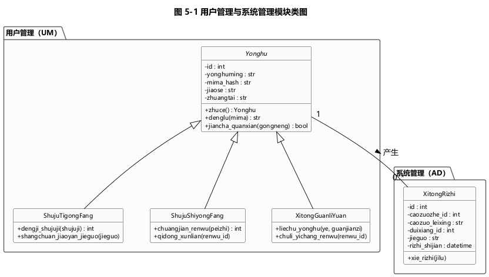
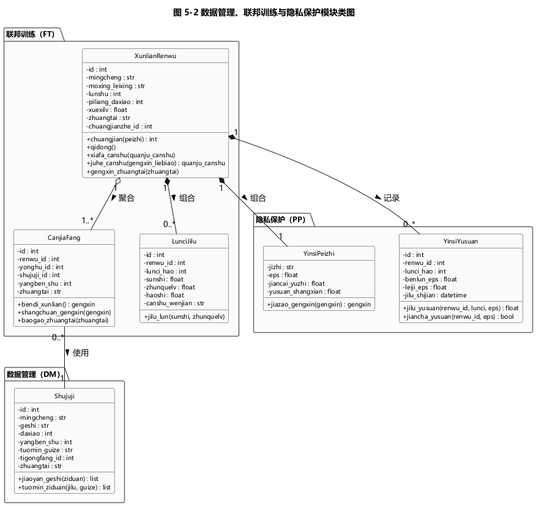
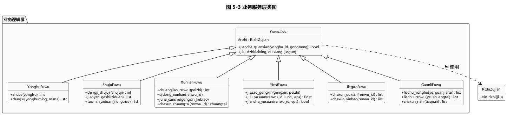
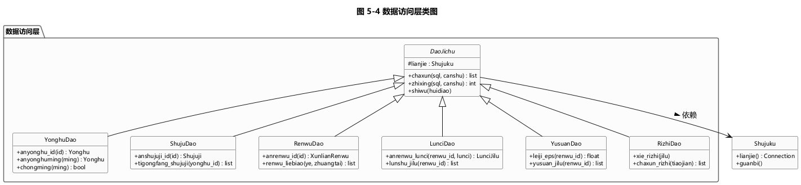
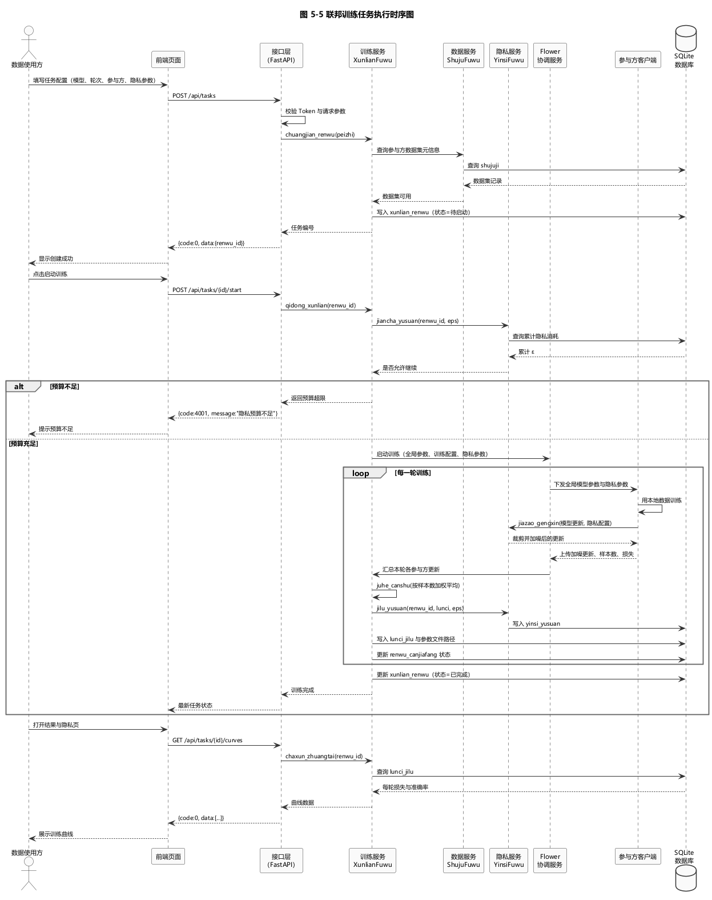
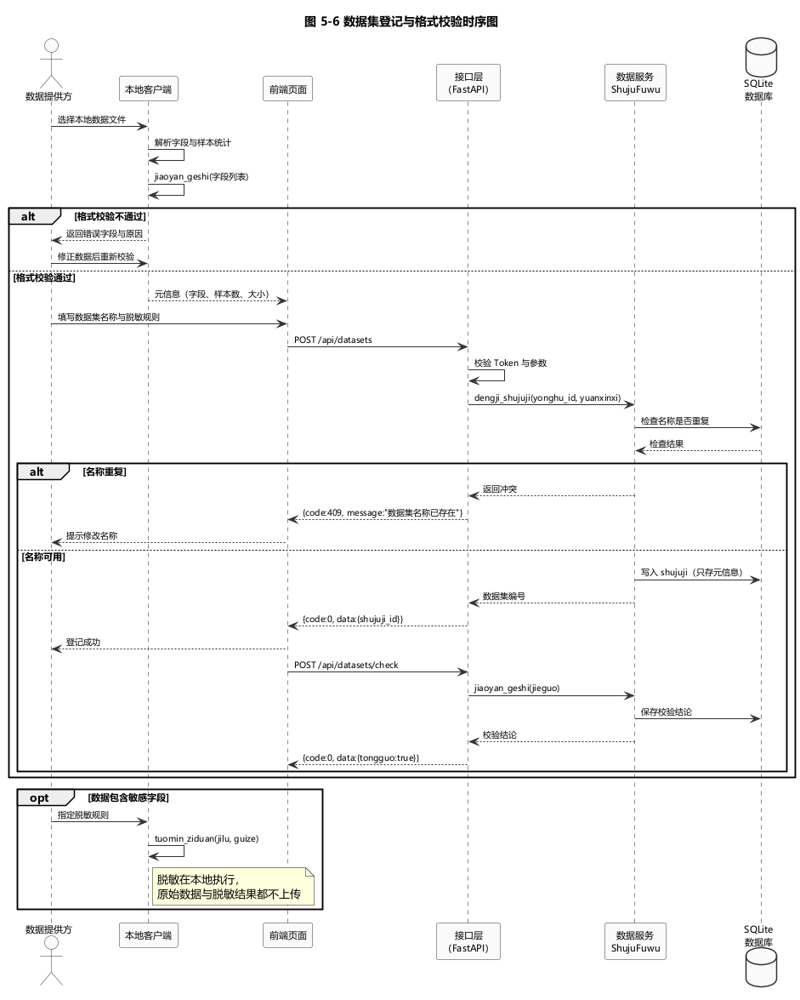
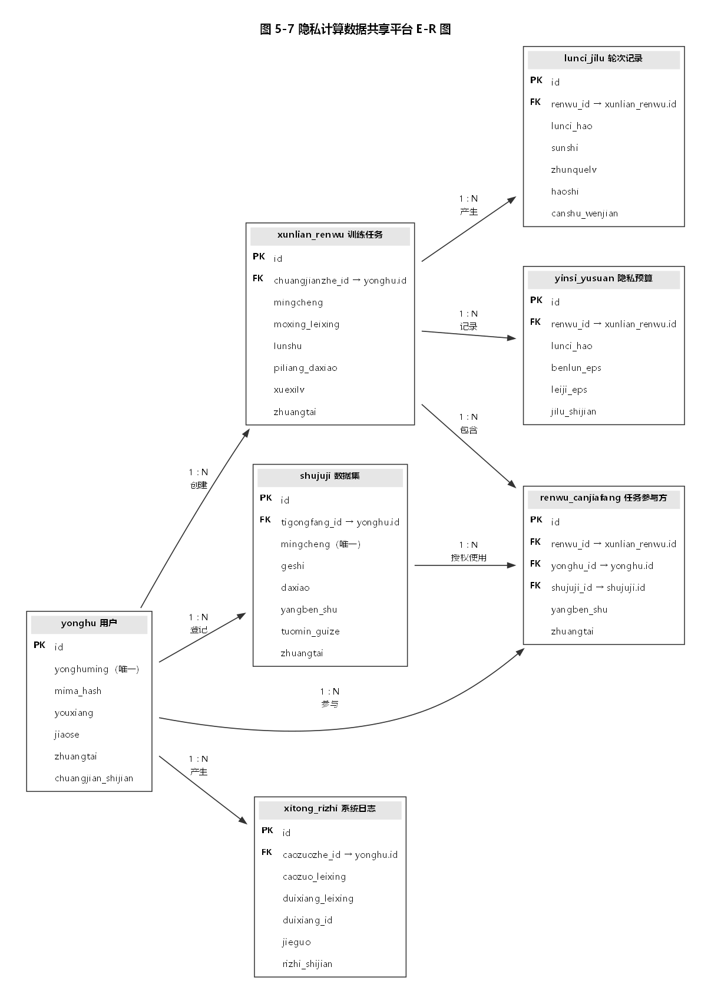

# 实验5：系统详细设计

## 一、实验目的

1. 掌握详细设计的基本方法，能够把概要设计中的模块细化成类、属性、方法和类之间的关系。
2. 学会针对核心模块绘制类图，正确使用继承、关联、聚合和组合等关系。
3. 学会绘制关键业务的时序图，用对象之间的消息交互说明一条完整业务流程。
4. 完成数据库逻辑设计，绘制 E-R 图，定义主键、外键和完整性约束，并检查设计是否符合第三范式。
5. 检查详细设计对实验2需求、实验3用例和实验4接口的落实，保证设计链条完整。

## 二、实验环境

| 项目 | 内容 |
| --- | --- |
| 操作系统 | Windows 11 |
| 运行环境 | OpenJDK 17.0.20.1 |
| 建模工具 | PlantUML 1.2024.7（类图、时序图） |
| 图形工具 | Graphviz 16.1.0（E-R 图） |
| 后端技术 | Python 3.9+、FastAPI、SQLite |
| 联邦学习 | Flower、PyTorch |
| 前端技术 | Vue.js |
| 项目 | 隐私计算数据共享平台（联邦学习 + 差分隐私） |

建模源文件位于 `Experiment5/uml/`，图片同时输出 PNG 和 SVG。类名、方法名沿用实验4确定的拼音命名规范，与模块内部接口名保持一致，避免设计文档和代码阶段出现两套叫法。

## 三、实验内容与步骤

### 3.1 详细设计的输入与目标

详细设计以实验4的概要设计为输入，把“系统由哪些模块组成”进一步细化成“每个模块里有哪些类、类怎么协作、数据怎么存”。

| 输入 | 内容 | 在详细设计中的用途 |
| --- | --- | --- |
| 实验2 SRS | 17 项功能需求、13 项非功能需求 | 类职责和数据库约束的来源 |
| 实验3 用例模型 | 用例图和 4 个核心用例描述 | 时序图的流程来源 |
| 实验4 概要设计 | 四层架构、6 个模块、18 个模块内部接口 | 类的划分依据和消息名称来源 |
| 实验4 设计决策 | MLP 模型、拉普拉斯机制、裁剪阈值、加权聚合、参数文件存储 | 属性和数据表的取值范围 |

详细设计要回答三个问题：

1. **类的设计**：每个核心模块有哪些类，类的属性、方法是什么，类之间是什么关系。
2. **流程的设计**：关键业务在对象之间如何一步步完成，异常分支怎么走。
3. **数据的存储**：需要哪些表，主键外键怎么定，是否满足第三范式。

### 3.2 类设计

#### 3.2.1 类的识别与职责划分

从概要设计的六个模块出发，按“实体类 + 服务类 + 数据访问类”三类划分：

| 类名 | 中文含义 | 所属模块 | 主要职责 | 对应需求 |
| --- | --- | --- | --- | --- |
| `Yonghu` | 用户（抽象类） | UM | 保存账号信息，提供注册、登录、权限判断 | FR-UM-001～003 |
| `ShujuTigongFang` | 数据提供方 | UM | 登记数据集、提交格式校验结果 | FR-DM-001、FR-DM-003 |
| `ShujuShiyongFang` | 数据使用方 | UM | 创建和启动训练任务 | FR-FT-001 |
| `XitongGuanliYuan` | 系统管理员 | UM | 查询用户、处理异常任务 | FR-AD-001 |
| `XitongRizhi` | 系统日志 | AD | 记录操作者、操作类型、对象和结果 | FR-AD-002 |
| `Shujuji` | 数据集 | DM | 保存数据集元信息，提供格式校验和脱敏规则 | FR-DM-001～003 |
| `XunlianRenwu` | 训练任务 | FT | 保存任务配置，编排训练流程和参数聚合 | FR-FT-001～004 |
| `CanjiaFang` | 任务参与方 | FT | 保存某个任务中某个参与方的数据集和状态 | FR-FT-002 |
| `LunciJilu` | 轮次记录 | FT/RV | 保存每轮的损失、准确率、耗时和参数文件 | FR-FT-004、FR-RV-001 |
| `YinsiPeizhi` | 隐私配置 | PP | 保存噪声机制、ε、裁剪阈值和预算上限，执行加噪 | FR-PP-001 |
| `YinsiYusuan` | 隐私预算 | PP | 记录每轮消耗和累计消耗，判断是否超限 | FR-PP-002 |
| `FuwuJichu` | 业务服务基类（抽象类） | 业务层 | 统一实现权限检查和日志记录 | FR-UM-003、FR-AD-002 |
| `YonghuFuwu` 等 6 个服务类 | 各模块业务服务 | 业务层 | 实现六个模块的业务规则 | 全部 FR |
| `DaoJichu` | 数据访问基类（抽象类） | 数据层 | 统一封装连接、查询、执行和事务 | — |
| `YonghuDao` 等 6 个 DAO | 各表数据访问 | 数据层 | 提供按主键查询、条件查询和写入 | — |

说明：`Yonghu` 设计成抽象类，三个角色类继承它，共用账号、密码、角色、状态等属性；这样登录和权限判断只在父类实现一次，子类只增加各自的业务方法。数据库层面不建三张用户表，而是用 `yonghu.jiaose` 字段区分角色，类图的继承在存储层映射为角色字段，这一点在 3.4.6 节说明。

#### 3.2.2 用户管理与系统管理模块类图

用户管理和系统管理模块的类图如图 5-1 所示。

图 5-1 用户管理与系统管理模块类图

类之间的关系：

| 关系 | 两端 | 类型 | 说明 |
| --- | --- | --- | --- |
| 继承 | `Yonghu` ← `ShujuTigongFang` | 泛化 | 数据提供方是一种用户，复用登录和权限判断 |
| 继承 | `Yonghu` ← `ShujuShiyongFang` | 泛化 | 数据使用方是一种用户 |
| 继承 | `Yonghu` ← `XitongGuanliYuan` | 泛化 | 系统管理员是一种用户 |
| 关联 | `Yonghu` 1 — 0..* `XitongRizhi` | 关联 | 一个用户可以产生多条日志，日志记录操作者编号 |

设计说明：

1. `Yonghu` 的三个属性 `mima_hash`、`jiaose`、`zhuangtai` 设为私有，子类通过父类方法访问，保证密码哈希逻辑只有一处实现。
2. `jiancha_quanxian` 放在父类，接口层每次请求只调用一次，不把权限判断散落到各个子类。
3. `XitongRizhi` 与 `Yonghu` 是普通关联而不是组合：日志在用户注销后仍需保留，不随用户对象销毁。
4. 管理员类只增加“查询用户”和“处理异常任务”两个方法，没有直接操作训练数据的入口，与 SRS 中管理员的权限边界一致。

#### 3.2.3 数据管理、联邦训练与隐私保护模块类图

这三个模块构成系统的核心业务，类图如图 5-2 所示。

图 5-2 数据管理、联邦训练与隐私保护模块类图

类之间的关系：

| 关系 | 两端 | 类型 | 说明 |
| --- | --- | --- | --- |
| 聚合 | `XunlianRenwu` 1 ◇— 1..* `CanjiaFang` | 聚合 | 任务是参与方的容器，参与方可以独立存在并被多个任务复用 |
| 组合 | `XunlianRenwu` 1 ◆— 0..* `LunciJilu` | 组合 | 轮次记录随任务删除而删除，不能脱离任务存在 |
| 组合 | `XunlianRenwu` 1 ◆— 1 `YinsiPeizhi` | 组合 | 隐私配置属于任务，任务创建时确定，随任务生命周期存在 |
| 组合 | `XunlianRenwu` 1 ◆— 0..* `YinsiYusuan` | 组合 | 预算记录是任务运行过程的产物，同生共死 |
| 关联 | `CanjiaFang` 0..* — 1 `Shujuji` | 关联 | 一个参与方在任务中使用一个数据集 |
| 依赖 | `CanjiaFang` ⇢ `YinsiPeizhi` | 依赖 | 参与方客户端本地训练后调用加噪方法，不持有配置对象 |

设计说明：

1. **聚合和组合的区分**：参与方对象由数据提供方在平台上的数据授权关系决定，任务结束后依然存在，所以用聚合；轮次记录、隐私预算、隐私配置都是任务运行中产生的，任务删除后没有保留价值，所以用组合。这一区分直接决定了数据库外键的删除策略。
2. **隐私保护独立成类而不是方法**：`YinsiPeizhi.jiazao_gengxin` 是纯函数式的加噪入口，先按 `jiancai_yuzhi` 做 L2 裁剪，再按 `eps` 加拉普拉斯噪声，不依赖当前登录用户，方便单独做单元测试。
3. **YinsiYusuan 单独建类**：预算记录会被训练服务和结果展示服务同时读取，单独成类后两个模块都只依赖这张记录，不各自维护一份累计值。
4. **LunciJilu.canshu_wenjian 只存路径**：模型参数文件按“任务编号/轮次”保存在磁盘，数据库只放文件引用，避免大文件写进 SQLite，符合实验4的 TBD-06。

#### 3.2.4 业务服务层与数据访问层类图

业务服务层把接口层的请求翻译成领域对象操作，类图如图 5-3 所示。

图 5-3 业务服务层类图

数据访问层封装全部 SQL，类图如图 5-4 所示。

图 5-4 数据访问层类图

设计说明：

1. `FuwuJichu` 作为抽象基类，实现权限判断和日志记录两个所有服务都要用的方法，六个具体服务继承它，避免每个服务各写一遍。
2. 六个服务类与六个模块一一对应，类名与实验4的模块编号对应：`YonghuFuwu`（UM）、`ShujuFuwu`（DM）、`XunlianFuwu`（FT）、`YinsiFuwu`（PP）、`JieguoFuwu`（RV）、`GuanliFuwu`（AD）。
3. `DaoJichu` 封装 `chaxun`、`zhixing` 和 `shiwu`，具体 DAO 只写各自的 SQL 和结果映射，SQL 不散落在业务代码里，对应概要设计中“业务模块不直接拼接 SQL”的约定。
4. `Shujuku` 负责连接创建和关闭，`DaoJichu` 通过组合持有它；连接池参数、事务边界都在这两个类里控制。
5. `RizhiZujian` 位于公共组件，被 `FuwuJichu` 使用。日志写在接口层的统一组件里，系统管理模块只负责查询，避免出现实验4中提到过的双向依赖。

#### 3.2.5 类设计的检查

1. **继承用得克制**：只有两组继承——用户按角色泛化、服务与 DAO 抽公共基类。没有为了用继承而把没有共同行为的类强行放进一个父类。
2. **关系语义准确**：任务与轮次是组合，任务与参与方是聚合，客户端加噪是依赖。不同关系对应不同的对象生命周期和数据库删除策略。
3. **方法可追溯到接口**：类图中的方法名与实验4的 18 个内部接口一一对应，例如 `chuangjian_renwu`、`jiazao_gengxin`、`juhe_canshu`、`chaxun_quxian`，没有凭空新增业务方法。
4. **可见性合理**：属性全部私有或受保护，对外只暴露方法；`FuwuJichu.rizhi` 和 `DaoJichu.lianjie` 用受保护，供子类使用但不对外公开。

### 3.3 关键业务时序图

#### 3.3.1 联邦训练任务执行时序图

联邦训练是系统的核心业务，覆盖任务创建、启动、逐轮训练、聚合、预算记录和结果查询，如图 5-5 所示。

图 5-5 联邦训练任务执行时序图

流程说明：

1. **创建任务**：数据使用方在前端填写模型类型、轮次、参与方和隐私参数，接口层校验 Token 后调用 `chuangjian_renwu`。训练服务先通过数据服务确认每个参与方的数据集可用，再把任务以“待启动”状态写入数据库。
2. **启动前的预算检查**：调用 `qidong_xunlian` 后，训练服务先向隐私服务查询该任务的累计隐私消耗。如果加上本轮 ε 会超过任务创建时指定的预算上限，直接返回 4001 错误，任务不进入训练。
3. **逐轮训练**：协调服务把全局模型参数、训练配置（批大小、学习率、本地轮数）和隐私参数下发给各参与方；参与方在本地数据上训练，调用 `jiazao_gengxin` 先裁剪再加噪，然后上传加噪后的模型更新、样本数和损失值。
4. **聚合**：训练服务调用 `juhe_canshu`，按样本数加权平均各参与方的更新，得到新的全局参数。
5. **记录**：每轮结束后，隐私服务通过 `jilu_yusuan` 把本轮 ε 和累计 ε 写入隐私预算表，训练服务把损失、准确率、耗时和参数文件路径写入轮次记录表，并更新参与方状态。
6. **结束**：全部轮次完成后，任务状态改为“已完成”；异常中断时由管理员通过异常任务处理入口改状态，不直接改训练数据。
7. **结果查询**：前端通过 `chaxun_zhuangtai` 和 `chaxun_quxian` 读取轮次记录，曲线数据只在服务端组装，前端不做状态推算。

异常分支：预算不足、参与方数据集被停用、某轮参与方掉线三种情况都在时序图中单独标出，分别返回 4001、4002、4003 业务错误码，任务状态停在“待启动”或“异常”，不会留下半轮数据。

#### 3.3.2 数据集登记与格式校验时序图

数据集从本地导入到登记完成的过程如图 5-6 所示。

图 5-6 数据集登记与格式校验时序图

流程说明：

1. 数据提供方在本地客户端选择数据文件，客户端完成字段解析、样本统计和 `jiaoyan_geshi` 格式校验；校验不通过时直接提示错误字段，不产生任何服务端数据。
2. 校验通过后，客户端只把元信息（字段列表、样本数、大小）交给前端，原始数据不离开本地。
3. 前端调用 `POST /api/datasets`，接口层完成认证和参数校验后调用 `dengji_shujuji`；数据服务先检查同一提供方下名称是否重复，重复返回 409，不重复则写入数据集表。
4. 前端再调用 `POST /api/datasets/check` 提交校验结论，`jiaoyan_geshi` 只保存结论和错误字段，不保存样本内容。
5. 可选步骤：如果数据包含敏感字段，数据提供方指定脱敏规则，客户端在本地执行 `tuomin_ziduan`，脱敏后的数据同样不上传。

#### 3.3.3 时序图的检查

1. 两条时序图都从参与者操作开始，到界面反馈结束，覆盖完整流程，不是只画中间一段。
2. 每个调用都能在类图中找到对应的方法，每个方法都能在实验4的接口表中找到对应条目，三层文档能对上。
3. 异常分支明确：预算不足、名称重复、格式校验失败三种情况都给出了返回码和界面表现，没有“出错后重试”这类含糊描述。
4. 明确标注了“本地执行”的边界：格式校验、脱敏、加噪前的裁剪都在参与方一侧完成，服务端只接收元信息、结论和加噪后的更新。

### 3.4 数据库设计

#### 3.4.1 概念结构设计：E-R 图

系统共设计 7 张表：用户、数据集、训练任务、任务参与方、轮次记录、隐私预算、系统日志。E-R 图如图 5-7 所示。

图 5-7 隐私计算数据共享平台 E-R 图

实体之间的联系：

| 联系 | 实体 | 基数 | 说明 |
| --- | --- | --- | --- |
| 登记 | 用户—数据集 | 1 : N | 一个数据提供方可以登记多个数据集 |
| 创建 | 用户—训练任务 | 1 : N | 一个数据使用方可以创建多个任务 |
| 包含 | 训练任务—任务参与方 | 1 : N | 一个任务包含一个以上参与方 |
| 参与 | 用户—任务参与方 | 1 : N | 一个用户可以参与多个任务 |
| 授权使用 | 数据集—任务参与方 | 1 : N | 一个数据集可以在多个任务中被使用 |
| 产生 | 训练任务—轮次记录 | 1 : N | 一个任务产生多条轮次记录 |
| 记录 | 训练任务—隐私预算 | 1 : N | 一个任务有多条预算记录 |
| 产生 | 用户—系统日志 | 1 : N | 一个用户产生多条操作日志 |

“任务参与方”是多对多联系“用户参与任务”和“数据集用于任务”的联系实体，把两个多对多关系拆成两个一对多，避免表中出现复合的重复组。

#### 3.4.2 逻辑结构设计：数据表

**表 5-1 用户表 yonghu**

| 字段 | 类型 | 约束 | 说明 |
| --- | --- | --- | --- |
| id | INTEGER | PRIMARY KEY AUTOINCREMENT | 用户编号 |
| yonghuming | VARCHAR(32) | NOT NULL UNIQUE | 用户名，登录用 |
| mima_hash | VARCHAR(100) | NOT NULL | bcrypt 哈希后的密码 |
| youxiang | VARCHAR(64) | NOT NULL | 邮箱 |
| jiaose | VARCHAR(16) | NOT NULL CHECK 取值在 tigongfang、shiyongfang、guanliyuan 中 | 角色 |
| zhuangtai | VARCHAR(16) | NOT NULL DEFAULT zhengchang | 正常、停用 |
| chuangjian_shijian | DATETIME | NOT NULL DEFAULT 当前时间 | 注册时间 |

**表 5-2 数据集表 shujuji**

| 字段 | 类型 | 约束 | 说明 |
| --- | --- | --- | --- |
| id | INTEGER | PRIMARY KEY AUTOINCREMENT | 数据集编号 |
| tigongfang_id | INTEGER | NOT NULL，外键引用 yonghu(id) | 提供方 |
| mingcheng | VARCHAR(64) | NOT NULL，与 tigongfang_id 组成唯一约束 | 数据集名称 |
| geshi | VARCHAR(16) | NOT NULL | csv、json 等格式 |
| daxiao | INTEGER | NOT NULL CHECK 大于 0 | 文件大小（字节） |
| yangben_shu | INTEGER | NOT NULL CHECK 大于 0 | 登记时的样本数 |
| tuomin_guize | VARCHAR(200) | 可空 | 脱敏规则标识，不存规则内容 |
| zhuangtai | VARCHAR(16) | NOT NULL DEFAULT yijiaoyan | 待校验、已校验、已停用 |
| chuangjian_shijian | DATETIME | NOT NULL DEFAULT 当前时间 | 登记时间 |

**表 5-3 训练任务表 xunlian_renwu**

| 字段 | 类型 | 约束 | 说明 |
| --- | --- | --- | --- |
| id | INTEGER | PRIMARY KEY AUTOINCREMENT | 任务编号 |
| chuangjianzhe_id | INTEGER | NOT NULL，外键引用 yonghu(id) | 创建人 |
| mingcheng | VARCHAR(64) | NOT NULL | 任务名称 |
| moxing_leixing | VARCHAR(32) | NOT NULL DEFAULT mlp_64_32 | 模型类型 |
| lunshu | INTEGER | NOT NULL CHECK 大于 0 | 训练轮数 |
| piliang_daxiao | INTEGER | NOT NULL CHECK 大于 0 | 批大小 |
| xuexilv | REAL | NOT NULL CHECK 大于 0 | 学习率 |
| zhuangtai | VARCHAR(16) | NOT NULL DEFAULT daichufa | 待启动、训练中、已完成、异常 |
| chuangjian_shijian | DATETIME | NOT NULL DEFAULT 当前时间 | 创建时间 |

**表 5-4 任务参与方表 renwu_canjiafang**

| 字段 | 类型 | 约束 | 说明 |
| --- | --- | --- | --- |
| id | INTEGER | PRIMARY KEY AUTOINCREMENT | 记录编号 |
| renwu_id | INTEGER | NOT NULL，外键引用 xunlian_renwu(id) | 所属任务 |
| yonghu_id | INTEGER | NOT NULL，外键引用 yonghu(id) | 参与方用户 |
| shujuji_id | INTEGER | NOT NULL，外键引用 shujuji(id) | 本任务使用的数据集 |
| yangben_shu | INTEGER | NOT NULL CHECK 大于 0 | 本任务实际样本数，用于加权聚合 |
| zhuangtai | VARCHAR(16) | NOT NULL DEFAULT daixunlian | 待训练、训练中、已完成、掉线 |
| 唯一约束 | — | UNIQUE(renwu_id, yonghu_id) | 同一任务中一个参与方只出现一次 |

**表 5-5 轮次记录表 lunci_jilu**

| 字段 | 类型 | 约束 | 说明 |
| --- | --- | --- | --- |
| id | INTEGER | PRIMARY KEY AUTOINCREMENT | 记录编号 |
| renwu_id | INTEGER | NOT NULL，外键引用 xunlian_renwu(id) | 所属任务 |
| lunci_hao | INTEGER | NOT NULL CHECK 大于 0 | 轮次序号 |
| sunshi | REAL | NOT NULL | 全局损失 |
| zhunquelv | REAL | NOT NULL | 全局准确率 |
| haoshi | REAL | NOT NULL | 本轮耗时（秒） |
| canshu_wenjian | VARCHAR(200) | NOT NULL | 全局参数文件相对路径 |
| 唯一约束 | — | UNIQUE(renwu_id, lunci_hao) | 一个任务的同一轮只记一次 |

**表 5-6 隐私预算表 yinsi_yusuan**

| 字段 | 类型 | 约束 | 说明 |
| --- | --- | --- | --- |
| id | INTEGER | PRIMARY KEY AUTOINCREMENT | 记录编号 |
| renwu_id | INTEGER | NOT NULL，外键引用 xunlian_renwu(id) | 所属任务 |
| lunci_hao | INTEGER | NOT NULL CHECK 大于 0 | 轮次序号 |
| benlun_eps | REAL | NOT NULL CHECK 大于 0 | 本轮消耗 ε |
| leiji_eps | REAL | NOT NULL CHECK 大于 0 | 累计消耗 ε |
| jilu_shijian | DATETIME | NOT NULL DEFAULT 当前时间 | 记录时间 |
| 唯一约束 | — | UNIQUE(renwu_id, lunci_hao) | 同一轮只记一次预算 |

**表 5-7 系统日志表 xitong_rizhi**

| 字段 | 类型 | 约束 | 说明 |
| --- | --- | --- | --- |
| id | INTEGER | PRIMARY KEY AUTOINCREMENT | 日志编号 |
| caozuozhe_id | INTEGER | 可空，外键引用 yonghu(id) | 操作者，未登录操作为空 |
| caozuo_leixing | VARCHAR(32) | NOT NULL | 登录、创建任务、启动训练等 |
| duixiang_leixing | VARCHAR(32) | NOT NULL | 对象类型 |
| duixiang_id | INTEGER | 可空 | 对象编号 |
| jieguo | VARCHAR(16) | NOT NULL | 成功、失败、越权 |
| rizhi_shijian | DATETIME | NOT NULL DEFAULT 当前时间 | 发生时间 |

#### 3.4.3 完整性与约束设计

| 约束类型 | 落实方式 |
| --- | --- |
| 实体完整性 | 7 张表都用自增整数主键，主键不允许为空；参与方表、轮次表、预算表另有唯一约束，防止重复记录 |
| 参照完整性 | 数据集引用用户、任务引用用户、参与方引用任务和数据集、轮次和预算引用任务、日志引用用户，全部用外键声明 |
| 用户定义完整性 | 角色、任务状态、参与方状态用 CHECK 约束限定取值；轮数、批大小、学习率、ε 用 CHECK 限定为正数；同一提供方下数据集名称唯一 |
| 删除策略 | 任务删除时级联删除轮次记录和预算记录（组合关系）；数据集和用户被引用时禁止删除，改为置为停用状态，避免历史任务失去关联 |
| 安全约束 | 用户表只存密码哈希；日志表不记录密码、Token 和原始训练数据；数据集表不存原始文件，只存元信息和本地引用 |

#### 3.4.4 索引设计

| 索引 | 表 | 字段 | 用途 |
| --- | --- | --- | --- |
| 主键索引 | 全部 7 张表 | id | 按编号查询 |
| 唯一索引 | yonghu | yonghuming | 登录查询、注册查重 |
| 唯一索引 | shujuji | (tigongfang_id, mingcheng) | 同一提供方下名称查重 |
| 唯一索引 | renwu_canjiafang | (renwu_id, yonghu_id) | 防止重复参与 |
| 普通索引 | renwu_canjiafang | shujuji_id | 查询某数据集被哪些任务使用 |
| 普通索引 | lunci_jilu | (renwu_id, lunci_hao) | 训练曲线按轮次排序 |
| 普通索引 | yinsi_yusuan | renwu_id | 查询任务累计隐私消耗 |
| 普通索引 | xitong_rizhi | rizhi_shijian | 按时间范围查询日志 |

#### 3.4.5 范式分析

**第一范式（1NF）**：所有字段都是不可再分的原子值。脱敏规则只存规则标识，不把多个规则用逗号拼在一个字段里；数据集字段列表只在客户端校验时使用，不落库。因此不存在重复组和多值字段。

**第二范式（2NF）**：7 张表都以单列 `id` 作主键，非主属性完全依赖主键，不存在只依赖复合键一部分的属性。参与方表、轮次表、预算表的复合唯一约束只是候选键，不承担主键职责，因此不会出现部分依赖。

**第三范式（3NF）**：非主属性之间不存在传递依赖，具体处理如下。

| 可能的问题 | 处理方式 | 原因 |
| --- | --- | --- |
| 把模型参数文件路径放在任务表 | 放在轮次表 `lunci_jilu.canshu_wenjian` | 路径由“任务 + 轮次”决定，放任务表会出现一个任务多个路径的矛盾 |
| 把累计 ε 放在任务表 | 由预算表逐轮记录，累计值按 `SUM(benlun_eps)` 得到 | 累计值可由明细推导，存储会与明细不一致 |
| 把隐私参数（ε、裁剪阈值、预算上限）放在参与方表 | 在任务创建时固定，作为任务的属性或配置 | 同一任务的所有参与方共用同一套隐私参数 |
| 把参与方样本数放在数据集表 | 数据集表存登记时的样本数，参与方表存本任务实际样本数 | 两者语义不同：前者是元信息，后者是本次聚合权重，不能互相推导 |
| 把创建人姓名放在任务表 | 只存 `chuangjianzhe_id`，姓名通过关联查询 | 姓名依赖用户编号，存两份会产生更新异常 |

结论：7 张表均满足第三范式，没有部分依赖和传递依赖。

#### 3.4.6 类图与数据表的对应关系

| 类 | 表 | 映射说明 |
| --- | --- | --- |
| `Yonghu` 及三个角色子类 | yonghu | 继承关系映射为单表继承，用 `jiaose` 字段区分角色 |
| `Shujuji` | shujuji | 一一对应 |
| `XunlianRenwu` | xunlian_renwu | 一一对应 |
| `CanjiaFang` | renwu_canjiafang | 一一对应 |
| `LunciJilu` | lunci_jilu | 一一对应，参数文件只存路径 |
| `YinsiPeizhi` | xunlian_renwu 的隐私参数字段或任务配置文件 | 配置随任务创建确定，不单独建表 |
| `YinsiYusuan` | yinsi_yusuan | 一一对应 |
| `XitongRizhi` | xitong_rizhi | 一一对应 |

### 3.5 详细设计对概要设计的落实

| 概要设计内容 | 详细设计的落点 |
| --- | --- |
| 四层架构 | 类图按模块分层：`FuwuJichu` 及 6 个服务在业务层，`DaoJichu` 及 6 个 DAO 在数据层，接口层只做协议转换 |
| 6 个模块 | 6 个服务类与 6 个模块一一对应，类名与模块编号对应 |
| 18 个内部接口 | 全部成为类图中的方法，名称与实验4一致 |
| 13 个 REST 接口 | 时序图中标出调用路径，服务层方法接收接口层的入参 |
| 6 项 TBD 决策 | MLP 结构、拉普拉斯机制、裁剪阈值 1.0、ε=0.5、加权聚合、参数文件存储都体现在类的属性和数据表字段中 |
| 安全与日志要求 | 用户表只存哈希，日志表不存敏感字段，训练数据不出本地在时序图中单独标注 |

## 四、实验结果

1. 完成了 4 张类图，覆盖 6 个核心模块：用户与系统管理、数据管理/联邦训练/隐私保护、业务服务层、数据访问层。类图中包含继承、关联、聚合、组合和依赖 5 种关系。
2. 完成了 2 张关键业务时序图：联邦训练任务执行（含预算检查、逐轮训练、聚合、异常分支）和数据集登记与格式校验。
3. 完成了数据库设计，共 7 张表，全部给出字段、类型、主键、外键、唯一约束、CHECK 约束和索引；绘制了 E-R 图并说明了实体之间的联系和基数。
4. 对 7 张表做了 1NF、2NF、3NF 检查，说明了四类容易出现的传递依赖问题及处理方式。
5. 类、方法、数据表与实验2的需求编号、实验4的接口编号建立了对应关系，设计链条完整。

## 五、实验总结与心得

### 5.1 遇到的问题与解决

（1）角色到底用继承还是用字段。开始想给三种角色各建一张表，登录时再判断查哪张表，会导致登录逻辑重复三遍。后来把 `Yonghu` 设计成抽象类，三个角色类继承它，共用账号相关属性和登录方法；数据库仍用一张 `yonghu` 表加角色字段，类图的继承在存储层映射为单表继承，既避免了逻辑重复，也没有把数据库拆得过细。

（2）聚合和组合分不清。任务和参与方、任务和轮次记录看起来都是“包含”，但参与方在任务结束后还要被其他任务使用，轮次记录则随任务删除而没有保留意义。把前者定为聚合、后者定为组合后，数据库的删除策略也就自然确定：轮次记录和预算记录可以级联删除，参与方和数据集不能删，只能停用。

（3）累计隐私消耗要不要存。最初想在任务表里加一个 `leiji_eps` 字段，每轮更新一次。讨论后发现这是典型的传递依赖，累计值可以由预算明细求和得到，存下来只会带来不一致的风险。最终改为只存每轮明细，累计值查询时计算。

（4）模型参数文件放数据库还是磁盘。参数文件每轮几十 MB，写进 SQLite 会让备份和查询都变慢。最后在轮次表里只存文件相对路径，文件按“任务编号/轮次”命名保存，和实验4的 TBD-06 保持一致。

（5）时序图里“谁调用加噪”不好画。加噪发生在参与方本地，但它属于隐私保护模块的方法。最后用依赖关系表示：参与方客户端调用隐私服务的 `jiazao_gengxin`，不持有配置对象，这样既符合“算法集中在隐私模块”的划分，也没有让参与方变成隐私模块的组成部分。

### 5.2 收获

（1）类图不是把名词圈起来连箭头。每个关系都要回答生命周期问题：谁创建的、谁销毁的、能不能独立存在。想清楚这三件事，聚合、组合、关联的界线就清楚了。

（2）时序图最有价值的地方是异常分支。只画正常流程看不出设计好坏，把预算不足、名称重复、格式校验失败标出来，才会发现接口返回码和任务状态机需要提前定义。

（3）数据库设计的难点不在建表，而在判断哪些字段是冗余。样本数、累计 ε、创建人姓名这些字段看起来方便，但都是可以推导的，存下来就要额外维护一致性。

（4）详细设计要能对上概要设计和需求。每画一个类和方法，都要能说清楚它对应实验4的哪条接口、实验2的哪条需求；对不上就说明有遗漏或者设计跑偏了。

### 5.3 对后续实验的准备

实验6将进入编码阶段，本实验确定的类结构、方法签名和数据表结构可以直接作为代码骨架：服务类对应各模块的 Python 模块，DAO 对应数据访问文件，7 张表的建表语句可以先用 SQLite 建起来，方便后续单元测试和集成测试。
