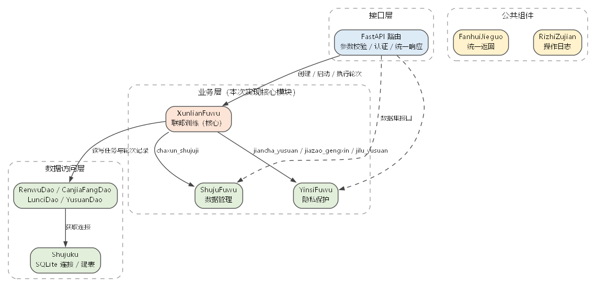

# 实验6：编码规范与模块化编程

## 一、实验目的

1. 掌握 Python 项目的编码规范，能够把命名、注释、格式和错误处理约定写成可执行的团队规范。
2. 学会按分层和模块划分源代码目录，使每个模块可以独立编译、独立运行、独立测试。
3. 能够把实验5的详细设计翻译成代码骨架，完成一个核心模块的主要业务逻辑。
4. 学会通过公开接口实现模块之间的调用，避免模块直接访问对方的内部数据和实现细节。
5. 掌握 Git 提交规范和 README 编写方法，使代码交付物可读、可查、可复现。

## 二、实验环境

| 项目 | 内容 |
| --- | --- |
| 操作系统 | Windows 11 |
| 运行环境 | Python 3.13.17 |
| 数据库 | SQLite 3（Python 标准库 sqlite3） |
| 测试框架 | unittest（Python 标准库） |
| 绘图工具 | Graphviz 16.1.0（模块依赖图） |
| 版本控制 | Git 2.x + GitHub |
| 项目 | 隐私计算数据共享平台（联邦学习 + 差分隐私） |

代码位于 `Experiment6/src/`，模块依赖图源文件位于 `Experiment6/uml/`。本次实现只使用 Python 标准库，不依赖 FastAPI、Flower、PyTorch 等框架，保证核心模块可以在任意装有 Python 3.10 以上版本的机器上单独运行。

## 三、实验内容与步骤

### 3.1 编码规范

编码规范不是写在纸上的口号，而是能落到代码检查里的约定。本实验从命名、注释、格式、错误处理和提交五个方面制定规范，并在 `Experiment6/README.md` 中给出摘要，方便后续实验沿用。

#### 3.1.1 命名规范

项目统一使用汉语拼音命名，避免同一个概念在不同模块里出现 `user`、`account`、`member` 三种叫法。类名用大驼峰，函数和变量用小写下划线，常量全大写；行业通用术语保留英文缩写，不强行音译。

| 项目 | 约定 | 示例 |
| --- | --- | --- |
| 类名 | 大驼峰，拼音全拼 | `XunlianFuwu`、`FanhuiJieguo`、`YinsiFuwu` |
| 函数名 | 小写下划线，动词在前 | `chuangjian_renwu`、`jiazao_gengxin`、`jiancha_yusuan` |
| 变量名 | 小写下划线，名词 | `canshu_wenjian`、`yusuan_shangxian`、`canjiafang` |
| 常量名 | 全大写，下划线分隔 | `CUOWU_YUSUAN`、`CUOWU_SHUJUJI` |
| 数据库表名 | 小写下划线，单数或集合含义明确 | `xunlian_renwu`、`renwu_canjiafang`、`yinsi_yusuan` |
| 数据库字段 | 小写下划线，与类属性同名 | `yusuan_shangxian`、`canshu_wenjian` |
| 前端组件 | 大驼峰，`.vue` 后缀 | `XunlianRenwu.vue`、`YinsiPeizhi.vue` |
| 前端变量与方法 | 小驼峰拼音 | `renwuId`、`chaxunZhuangtai` |
| 通用术语 | 保留英文，不音译 | `eps`、`hash`、`csv`、`token` |

命名还要满足三条约束：不使用无意义的单字母变量（循环下标除外）；不使用拼音和英文混拼的标识符；数据库字段名与实验5的类属性名保持一致，避免设计和代码两套叫法。

#### 3.1.2 注释规范

注释的目标是解释“为什么”，不是复述“做什么”。文件、类和公开方法必须写中文文档字符串，私有方法写一句话说明用途；行内注释只出现在需要解释设计取舍、边界条件或外部约束的地方；不允许保留被注释掉的旧代码。

```python
def jiancai_gengxin(self, gengxin: list[float],
                    jiancai_yuzhi: float) -> list[float]:
    """把模型更新的 L2 范数裁剪到阈值以内。"""
    fanzhi = math.sqrt(sum(x * x for x in gengxin))
    if fanzhi == 0 or fanzhi <= jiancai_yuzhi:
        return list(gengxin)
    bili = jiancai_yuzhi / fanzhi
    return [x * bili for x in gengxin]
```

反例是把方法名已经说明的事情再写一遍：

```python
# 计算范数
fanzhi = math.sqrt(sum(x * x for x in gengxin))  # 计算范数
```

这两行注释没有提供任何新信息，反而在修改代码时容易忘记同步。需要写的注释应该类似“样本数取服务端记录，不采用客户端上传值，防止聚合权重被篡改”，说明的是代码背后看不到的约束。

#### 3.1.3 格式规范

格式规范参照 PEP 8，并结合项目实际做了少量调整：

| 项目 | 规则 |
| --- | --- |
| 缩进 | 4 个空格，不使用制表符 |
| 行长 | 单行不超过 100 个字符 |
| 空行 | 顶层函数和类之间空两行，类内方法之间空一行 |
| 导入 | 标准库、第三方库、本项目模块分三组，组内按字母顺序 |
| 语句 | 一行只写一条语句，不使用分号 |
| 函数长度 | 单个函数不超过 50 行，超过时按职责拆分 |
| 类型标注 | 公开方法和关键内部方法标注参数与返回值类型 |
| 默认参数 | 不使用列表、字典等可变对象作为默认值 |
| 异常 | 只捕获具体异常类型，不使用裸 `except` 吞掉错误 |

本次提交前执行了 `python -m compileall` 做语法检查，并逐条人工核对 PEP 8 条款。由于本机没有安装 flake8，代码检查以编译、单元测试和人工核对为主；后续实验8会补充自动化检查。

#### 3.1.4 错误处理规范

业务错误不使用异常向上传递，而是统一返回 `FanhuiJieguo` 对象。接口层根据 `cuowu_ma` 组装响应，前端按错误码处理，不依赖 HTTP 状态码区分业务含义。错误码在 `gonggong/fanhui.py` 集中定义，禁止在业务代码里直接写魔法数字。

| 错误码 | 含义 | 触发场景 |
| --- | --- | --- |
| 4001 | 隐私预算不足 | 启动训练或执行下一轮时，累计 ε 将超过上限 |
| 4002 | 数据集不存在或不可用 | 数据集编号无效，或状态为停用 |
| 4003 | 参与方缺失、重复或掉线 | 更新列表与参与方列表不一致，或重复提交 |
| 4004 | 任务状态不允许当前操作 | 重复启动、非训练中执行轮次、轮次已用完 |
| 4005 | 参数不合法 | 名称为空、轮数或隐私参数不为正数 |
| 4006 | 数据集名称重复 | 同一提供方下登记同名数据集 |

错误处理还有两条约束：业务方法不返回 `None` 表示失败，必须返回带错误码的结果对象；参数错误在接口层先拦截一次，服务层再做一次防御性校验，不假设调用方一定传对。

#### 3.1.5 Git 提交规范

仓库采用 `master`、`dev`、`feature/*` 三类分支：`master` 保存可交付版本，`dev` 用于日常集成，功能开发在 `feature/` 分支完成后再合并。提交信息格式为“类型(范围): 说明”，类型取 `feat`、`fix`、`docs`、`test`、`chore`，范围写模块缩写。

| 提交示例 | 说明 |
| --- | --- |
| `feat(xunlian): 实现任务创建与启动校验` | 新增训练模块功能 |
| `feat(yinsi): 实现 L2 裁剪与拉普拉斯加噪` | 新增隐私保护功能 |
| `test(xunlian): 补充预算不足与参与方缺失用例` | 只改测试 |
| `docs: 补充实验6编码规范与 README` | 只改文档 |
| `chore: 忽略数据库与参数文件` | 构建或仓库配置 |

一次提交只做一件事，不把格式化、功能修改和文档更新混在同一个提交里。数据库文件、`__pycache__` 和训练参数文件通过 `.gitignore` 排除，不进入仓库。

### 3.2 模块化设计

#### 3.2.1 分层与分包

按照实验4的四层架构和实验5的类划分，源代码按“公共组件、数据访问、业务模块、装配入口、测试”五类分包：

| 包 | 职责 | 对应实验5的类或层 |
| --- | --- | --- |
| `gonggong/` | 统一返回结构、操作日志 | `FanhuiJieguo`、`RizhiZujian` |
| `cunchu/` | SQLite 连接、建表、各表 DAO | `Shujuku`、`DaoJichu` 及 6 个 DAO |
| `mokuai/` | 业务规则与流程编排 | `ShujuFuwu`、`YinsiFuwu`、`XunlianFuwu` |
| `zhuangpei.py` | 创建连接、DAO 和服务，完成依赖注入 | 组装层，不参与业务 |
| `tests/` | 单元测试 | 无 |
| `demo.py` | 可单独运行的演示入口 | 无 |

本次没有实现接口层和前端，原因是实验6要求“聚焦一个模块的核心代码”。`XunlianFuwu` 的公开方法就是接口层将来要调用的方法，名称与实验4的内部接口一致，接口层只需做协议转换和参数校验，不需要改动业务代码。

#### 3.2.2 模块依赖

模块依赖关系如图 6-1 所示。



图 6-1 核心模块与数据访问层的依赖关系

依赖关系遵循三条规则：

1. **单向依赖**：业务模块只依赖数据访问层，数据访问层不反向依赖业务模块；接口层只调用业务模块的公开方法。
2. **模块之间只通过接口调用**：`XunlianFuwu` 持有 `ShujuFuwu` 和 `YinsiFuwu` 的引用，只调用 `chaxun_shujuji`、`jiancha_yusuan`、`jiazao_gengxin`、`jilu_yusuan` 四个公开方法，不访问对方的 DAO，也不读对方的表。
3. **依赖注入**：所有服务通过构造函数接收 DAO 和协作服务，不在模块内部 `new` 数据库连接。这样测试时可以用临时数据库替换，模块可以独立运行。

数据管理模块和隐私保护模块之间没有依赖，二者都可以脱离训练模块单独测试。隐私保护模块的接口是纯函数式的，不读取当前登录用户，也不写业务表，只有一个 `jilu_yusuan` 会写预算记录，方便单独验证。

#### 3.2.3 目录结构

```text
Experiment6/src/
├── demo.py                     演示入口，可单独运行
├── zhuangpei.py                装配数据库、DAO 和服务
├── gonggong/
│   ├── fanhui.py               统一返回结构与错误码
│   └── rizhi.py                日志组件
├── cunchu/
│   ├── shujuku.py              SQLite 连接与 7 张表建表
│   └── dao.py                  YonghuDao、ShujuDao、RenwuDao 等
├── mokuai/
│   ├── shuju_fuwu.py           数据管理模块
│   ├── yinsi_fuwu.py           隐私保护模块
│   └── xunlian_fuwu.py         联邦训练模块（核心）
└── tests/
    └── test_xunlian_fuwu.py    8 个单元测试用例
```

每个包都有 `__init__.py`，包内模块只从本层或下层导入。`mokuai/` 下的三个文件互不导入对方的内部模块，训练模块只导入另外两个模块公开的服务类。

### 3.3 核心模块实现：联邦训练

#### 3.3.1 任务创建与参数校验

`XunlianFuwu.chuangjian_renwu` 接收发起人、任务名称、参与方列表、轮数、批大小、学习率和隐私参数，先做参数校验，再逐个检查参与方数据集，最后写入任务表和参与方表。校验规则如下。

| 校验项 | 规则 | 错误码 |
| --- | --- | --- |
| 任务名称 | 去除空白后不能为空 | 4005 |
| 轮数、批大小、学习率 | 必须为正数 | 4005 |
| ε、裁剪阈值、预算上限 | 必须为正数 | 4005 |
| 参与方数量 | 至少一个 | 4003 |
| 参与方字段 | 必须包含用户、数据集、样本数 | 4005 |
| 同一参与方 | 同一任务中不能重复 | 4003 |
| 样本数 | 必须为正整数 | 4005 |
| 数据集 | 必须存在且状态为已校验 | 4002 |

服务层重新检查数据集是否可用，而不是信任前端传来的状态。原因是任务创建和启动之间可能隔了一段时间，数据集可能已被提供方停用；实验5的时序图把这一检查放在服务端，代码与设计保持一致。

#### 3.3.2 逐轮训练与加权聚合

一轮训练按以下顺序执行：

1. 检查任务存在且状态为“训练中”，计算当前轮次，确认没有超过总轮数。
2. 检查上传的更新列表与任务参与方一一对应，缺一方或重复提交都返回 4003。
3. 检查隐私预算，累计 ε 加上本轮 ε 不超过上限才继续，否则返回 4001。
4. 对每个参与方的更新调用 `YinsiFuwu.jiazao_gengxin` 做裁剪和加噪，样本数取服务端参与方记录。
5. 调用 `juhe_canshu` 按样本数加权平均，得到新的全局参数。
6. 按样本数加权汇总损失和准确率，耗时取各参与方最大值。
7. 保存全局参数文件，写入预算记录和轮次记录；最后一轮结束时把任务状态改为“已完成”。

加权聚合的公式为：

`w = (n1·w1 + n2·w2 + … + nk·wk) / (n1 + n2 + … + nk)`

其中 `wi` 是第 i 个参与方加噪后的更新，`ni` 是服务端记录的该参与方样本数。样本数不使用客户端上传值，避免参与方虚报样本数来放大自己的聚合权重。聚合实现如下：

```python
def juhe_canshu(self, renwu_id: int,
                gengxin_list: list[dict]) -> list[float]:
    """按样本数加权平均各参与方的模型更新。"""
    if self.renwu_dao.chaxun_an_id(renwu_id) is None:
        raise ValueError('任务不存在')
    if not gengxin_list:
        raise ValueError('没有可以聚合的更新')
    weidu = len(gengxin_list[0]['gengxin'])
    for xiang in gengxin_list:
        if len(xiang['gengxin']) != weidu or xiang['yangben_shu'] <= 0:
            raise ValueError('参与方更新维度或样本数不合法')
    zong_yangben = sum(x['yangben_shu'] for x in gengxin_list)
    jieguo = []
    for i in range(weidu):
        jiaquan_he = sum(
            x['gengxin'][i] * x['yangben_shu'] for x in gengxin_list
        )
        jieguo.append(jiaquan_he / zong_yangben)
    return jieguo
```

轮次主流程本身只负责编排，具体检查、加噪、指标汇总和状态更新拆成四个私有方法，主流程控制在 38 行，符合“函数不超过 50 行”的规范。

#### 3.3.3 隐私保护调用

隐私保护模块先做 L2 裁剪，再按拉普拉斯机制加噪。裁剪保证单个参与方的更新范数不超过 `C`，加噪的尺度为 `b = C / ε`；实验4确定 `C = 1.0`、每轮 `ε = 0.5`，因此每轮噪声尺度为 2.0。

```python
def jiazao_gengxin(self, gengxin: list[float], eps: float,
                   jiancai_yuzhi: float,
                   suijishu: random.Random | None = None) -> list[float]:
    """裁剪后按拉普拉斯机制加噪，返回可直接上传的更新。"""
    if eps <= 0:
        raise ValueError('隐私预算 ε 必须为正数')
    suijishu = suijishu or random.Random()
    jiancai = self.jiancai_gengxin(gengxin, jiancai_yuzhi)
    biliang = jiancai_yuzhi / eps
    return [x + self._laplace_suijishu(biliang, suijishu) for x in jiancai]

@staticmethod
def _laplace_suijishu(biliang: float, suijishu: random.Random) -> float:
    """逆变换采样生成拉普拉斯噪声。"""
    jingdu = suijishu.random() - 0.5
    duishu = math.log(1.0 - 2.0 * abs(jingdu))
    return -biliang * math.copysign(1.0, jingdu) * duishu
```

`jiazao_gengxin` 允许传入随机数生成器，测试时用固定种子，生产环境使用默认随机源。这样既保证单元测试可重复，也不把随机性写死在业务代码里。加噪方法不读取用户信息、不访问数据库，训练模块只是通过构造函数拿到它的引用，符合实验5“隐私保护接口是纯函数式调用”的约定。

#### 3.3.4 参数文件与轮次记录

全局参数每轮写成一个 JSON 文件，路径为 `canshu/{任务编号}/lunci_{轮次}.json`，数据库的 `lunci_jilu.canshu_wenjian` 只保存相对路径。这样避免了每轮几十 MB 的参数写进 SQLite，也与实验4的 TBD-06 一致。

一轮结束后的写入顺序是：先检查预算，再写参数文件，最后写预算记录和轮次记录。预算检查在写文件之前完成，预算不足时直接返回 4001，不会留下半轮记录；参数文件与轮次记录一一对应，任务删除时轮次记录级联删除，参数文件由后续的清理任务按任务编号删除。

### 3.4 模块间接口调用

训练模块对另外两个模块的调用关系如下表所示。

| 调用方 | 被调用方 | 接口 | 输入 | 输出 |
| --- | --- | --- | --- | --- |
| `XunlianFuwu` | `ShujuFuwu` | `chaxun_shujuji` | 数据集编号 | 数据集元信息或失败原因 |
| `XunlianFuwu` | `YinsiFuwu` | `jiancha_yusuan` | 任务编号、本轮 ε | 是否允许继续 |
| `XunlianFuwu` | `YinsiFuwu` | `jiazao_gengxin` | 模型更新、ε、裁剪阈值 | 加噪后的更新 |
| `XunlianFuwu` | `YinsiFuwu` | `jilu_yusuan` | 任务编号、轮次、本轮 ε | 累计 ε、剩余预算 |
| `XunlianFuwu` | `YinsiFuwu` | `chaxun_leiji` | 任务编号 | 累计 ε（查询状态时使用） |

模块调用遵守四条约束：

1. 只调用公开方法，不访问对方的 DAO、不直接读写对方的表。
2. 不共享全局变量，协作对象通过构造函数注入，测试时可以替换为桩对象。
3. 参数只传数据对象或字典，不传数据库连接；返回值统一用 `FanhuiJieguo`，调用方根据 `chenggong` 和 `cuowu_ma` 处理。
4. 依赖方向固定为“训练模块 → 数据模块、隐私模块”，数据模块和隐私模块不反向依赖训练模块，也不互相依赖。

### 3.5 代码质量与运行验证

#### 3.5.1 单元测试

`tests/test_xunlian_fuwu.py` 使用 unittest 编写了 8 个用例，每个用例使用独立的临时数据库和临时参数目录，互不影响。

| 用例 | 验证内容 | 结果 |
| --- | --- | --- |
| `test_jiaquan_juhe` | 样本数为 1:3 时聚合结果为 3.5 和 1.0 | 通过 |
| `test_jiancai_baozheng_fanzhi` | 裁剪后更新范数等于阈值 1.0 | 通过 |
| `test_jiazao_ke_chongfu` | 相同随机种子生成相同加噪结果，且噪声确实改变数值 | 通过 |
| `test_yusuan_buzu_shibai` | 预算 0.5、每轮 0.5 时第二轮返回 4001 | 通过 |
| `test_shujuji_tingyong_hou_qidong_shibai` | 数据集停用后启动返回 4002 | 通过 |
| `test_wanzheng_yilun` | 单轮训练完成后状态为已完成，参数文件存在，剩余预算 1.5 | 通过 |
| `test_chongfu_shujuji_mingcheng` | 同一提供方重名登记返回 4006 | 通过 |
| `test_canjiafang_gengxin_bu_wanzheng` | 缺少一个参与方的更新返回 4003 | 通过 |

测试运行结果（为便于排版，省略了每个用例的模块路径）：

```text
test_canjiafang_gengxin_bu_wanzheng ... ok
test_chongfu_shujuji_mingcheng ... ok
test_jiancai_baozheng_fanzhi ... ok
test_jiaquan_juhe ... ok
test_jiazao_ke_chongfu ... ok
test_shujuji_tingyong_hou_qidong_shibai ... ok
test_wanzheng_yilun ... ok
test_yusuan_buzu_shibai ... ok

Ran 8 tests in 0.464s

OK
```

#### 3.5.2 演示程序运行结果

`python demo.py` 从登记数据集开始，完整走一遍“创建任务、启动训练、执行三轮、查询状态”的流程，运行结果如下。

```text
登记数据集： 数据集登记成功 数据集登记成功
创建任务： 任务创建成功
启动任务： 训练已启动
第 1 轮：损失 0.9000，准确率 0.70，累计 ε 0.5，剩余预算 1.5
第 2 轮：损失 0.4500，准确率 0.80，累计 ε 1.0，剩余预算 1.0
第 3 轮：损失 0.3000，准确率 0.90，累计 ε 1.5，剩余预算 0.5
任务最终状态： yiwancheng
已完成轮次： 3
参数文件： ['lunci_1.json', 'lunci_2.json', 'lunci_3.json']
```

演示中任务预算为 2.0，每轮消耗 0.5，三轮共消耗 1.5，剩余 0.5，与预算记录一致。任务在第三轮结束后自动变为已完成，三个参数文件分别对应三轮全局参数。

#### 3.5.3 可读性与可维护性检查

| 指标 | 结果 | 说明 |
| --- | --- | --- |
| 功能源文件数 | 10 个 | 另有 4 个包声明文件 |
| 代码总行数 | 1021 行 | 含演示和测试 |
| 最长函数 | 38 行 | `zhixing_lunci`，其余主要函数不超过 31 行 |
| 最长文件 | 264 行 | `mokuai/xunlian_fuwu.py` |
| 单行长度 | 全部不超过 100 字符 | 已用脚本逐行检查 |
| SQL 分布 | 只出现在 `cunchu/dao.py` | 业务层没有拼接 SQL |
| 重复的错误处理 | 集中在 `FanhuiJieguo` | 各模块不重复写返回结构 |
| 新增一个模块的成本 | 加一个 DAO、一个服务类、一行装配代码 | 不需要修改已有模块 |

可维护性还体现在测试和演示的写法上：两者都通过 `Zhuangpei` 装配对象，使用临时目录，不依赖本机已有数据库；换一台机器只要装有 Python 3.10 以上版本就能直接运行。

### 3.6 Git 提交与 README

`Experiment6/README.md` 包含实现范围、目录结构、运行步骤、核心模块说明、编码规范摘要和 Git 约定六部分。运行步骤给出两条命令：`python demo.py` 和 `python -m unittest discover -s tests -v`，并说明只依赖标准库，评审者不需要配置虚拟环境。

本实验的提交记录如下。

| 提交 | 说明 |
| --- | --- |
| `feat(xunlian): 实现联邦训练模块核心流程` | 任务创建、启动、逐轮训练、聚合与状态查询 |
| `feat(yinsi): 实现裁剪、加噪与预算检查` | 隐私保护模块及预算记录 |
| `feat(shuju): 实现数据集登记与查询` | 数据管理模块 |
| `test(xunlian): 补充 8 个单元测试用例` | 聚合、裁剪、预算、状态与异常分支 |
| `docs: 补充实验6编码规范与 README` | 实验内容文档和运行说明 |
| `chore: 添加 .gitignore` | 排除数据库、参数文件和缓存 |

提交信息采用“类型(范围): 说明”的格式，范围使用模块拼音缩写，说明写清楚做了什么，避免“update”“fix bug”这类无法追溯的提交。

## 四、实验结果

1. 制定了覆盖命名、注释、格式、错误处理和 Git 提交的编码规范，并在代码中逐条落实；全部源文件通过 `compileall` 语法检查，单行不超过 100 字符。
2. 按五类包组织了源代码，模块依赖单向，核心模块 `XunlianFuwu` 只通过四个公开接口调用数据管理和隐私保护模块。
3. 完成了联邦训练核心模块：任务创建与校验、启动检查、逐轮训练、按样本数加权聚合、参数文件保存、预算与轮次记录、状态查询。
4. 编写了 8 个单元测试，覆盖聚合、裁剪、加噪可重复性、预算不足、数据集停用、完整单轮训练、名称重复和参与方缺失，全部通过。
5. 演示程序完整运行三轮训练，任务状态、累计隐私预算和参数文件均与设计一致；README 和提交记录满足“模块独立运行、提交信息清晰”的要求。

## 五、实验总结与心得

### 5.1 遇到的问题与解决

（1）拼音命名和框架命名冲突。项目统一用拼音后，`list`、`json`、`math` 这类标准库名称不能改，`FastAPI`、`Flower` 这类框架名也不能音译。最后在规范里划了一条边界：自有代码用拼音，标准库、第三方库和行业通用术语保留原名，命名检查时只检查自有标识符。

（2）`zhixing_lunci` 初版写了 80 多行。功能跑通后发现它同时做了状态检查、参与方校验、预算检查、加噪、聚合、指标汇总、文件保存和状态更新，读一遍要来回翻。后来拆成 `_jiancha_lunci`、`_jiaguan_benlun`、`_jihe_zhibiao`、`_jieshu_lunci` 四个私有方法，主流程降到 38 行，每个方法只做一件事，测试也更容易定位问题。

（3）加权聚合的样本数从哪里取。最初直接使用参与方上传的 `yangben_shu`，后来意识到参与方可以虚报样本数来放大自己的权重。改为使用服务端 `renwu_canjiafang` 表里登记的本任务样本数，客户端上传的样本数只用于核对，不参与聚合。

（4）预算检查放在什么时候。只在启动时检查不够，因为多轮训练会持续消耗预算；只在每轮前检查也不够，因为启动时就应该拒绝明显超限的任务。最后在 `qidong_xunlian` 和 `zhixing_lunci` 各检查一次，预算不足时返回 4001，任务不进入训练或停在当前轮之前，不留下半轮数据。

（5）模块如何独立测试。如果服务类自己创建数据库连接，测试就会互相污染。改为构造函数注入 DAO 和协作服务，测试用临时目录建库，每个用例独立运行；演示程序也通过 `Zhuangpei` 装配，不依赖本机数据。

### 5.2 收获

（1）编码规范的价值在于减少选择。命名、注释、格式这些约定一旦固定，写代码时不用反复纠结，评审时也有统一的检查依据。

（2）模块化不是把文件拆开，而是把依赖方向固定下来。训练模块能独立运行，是因为它只依赖数据模块和隐私模块的公开接口，不依赖它们的内部实现。

（3）测试会反过来推动设计。写“参与方缺失”和“预算不足”两个用例时，发现原来的主流程把校验和业务混在一起，拆分后不仅测试好写，代码也更好读。

（4）README 和提交记录是交付物的一部分。评审者先看 README 能不能跑起来，再看提交记录能不能追溯每个功能的来源；代码写得再好，没有这两样也很难复现。

### 5.3 对后续实验的准备

实验7进入版本控制与团队协作，本实验的提交规范和 `.gitignore` 可以直接沿用；实验8进入单元测试，现有 8 个用例可以作为基线，继续补充数据管理、隐私保护和接口层的测试。接口层和前端尚未实现，后续可以在不改动核心模块的前提下，按 `XunlianFuwu` 的公开方法补齐 FastAPI 路由和 Vue 页面。
