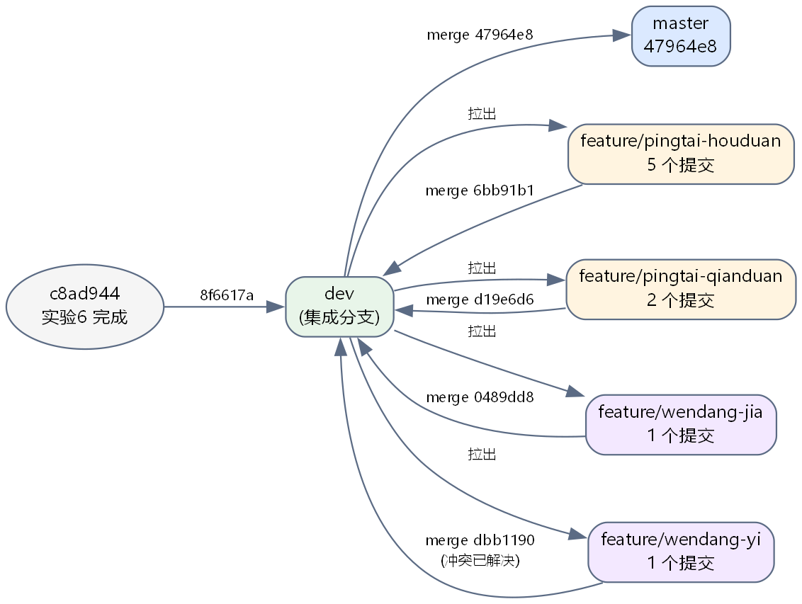

# 实验7：版本控制与团队协作

## 一、实验目的

1. 掌握 Git 的核心操作：初始化、提交、分支、合并、冲突解决与历史查看。
2. 能够为多人协作项目制定可执行的分支策略，区分长期分支与短期功能分支。
3. 学会编写规范的提交信息，使每一次提交都能说明"改了什么、为什么改"。
4. 能够复现并解决合并冲突，理解冲突产生的原因和正确的处理方式。
5. 把前面实验积累的代码与文档纳入版本管理，形成完整、可追溯的仓库历史。

## 二、实验环境

| 项目 | 内容 |
| --- | --- |
| 操作系统 | Windows 11 |
| 版本控制 | Git 2.x |
| 远程仓库 | GitHub（Alanxbr/SoftwareEngineering-Lab） |
| 本地仓库 | D:\SoftwareEngineering-Lab |
| 开发工具 | VS Code、Python 3.13、FastAPI |
| 项目 | 隐私计算数据共享平台（联邦学习 + 差分隐私） |

仓库在实验1 创建，实验3 至实验6 的 UML 源文件、设计文档、核心模块代码和 README 均已入库。本实验把完整的平台实现（`Platform/` 目录）纳入版本管理，并补齐分支策略、提交规范与协作流程。

## 三、实验内容与步骤

### 3.1 分支策略

仓库采用"两条长期分支 + 多条短期功能分支"的策略：

| 分支类型 | 名称 | 生命周期 | 用途 |
| --- | --- | --- | --- |
| 长期分支 | `master` | 全程保留 | 可交付版本，只接受来自 `dev` 的合并 |
| 长期分支 | `dev` | 全程保留 | 集成分支，汇总各功能分支的成果 |
| 功能分支 | `feature/pingtai-houduan` | 开发期间 | 平台后端：骨架、DAO、服务、路由、联邦训练 |
| 功能分支 | `feature/pingtai-qianduan` | 开发期间 | 平台前端：框架与 10 个页面 |
| 功能分支 | `feature/wendang-jia` | 文档演示 | 演示冲突的分支 A |
| 功能分支 | `feature/wendang-yi` | 文档演示 | 演示冲突的分支 B |

约束如下：功能分支一律从 `dev` 拉出；功能完成后合并回 `dev`；`dev` 在整体验证通过后才合入 `master`；`master` 上不允许直接提交功能代码。合并统一使用 `--no-ff`，保留分支拓扑，便于回溯"某个功能来自哪条分支"。


图 7-1 分支策略与合并拓扑

### 3.2 提交规范

提交信息沿用实验6 约定的格式：

```
类型(范围): 说明

- 变更要点
```

| 类型 | 含义 | 示例 |
| --- | --- | --- |
| `feat` | 新增功能 | `feat(qianduan): 实现 10 个业务页面` |
| `fix` | 修复缺陷 | `fix(dao): 日志按结束日期筛选漏掉当天记录` |
| `docs` | 文档变更 | `docs(pingtai): 编写平台 README 与演示说明` |
| `test` | 测试相关 | `test(xunlian): 补充 8 个单元测试用例` |
| `chore` | 构建、配置、杂项 | `chore: 忽略平台运行数据与日志` |
| `merge` | 分支合并 | `merge: 平台后端合入 dev` |

提交粒度按"一个可独立理解的最小变更"划分，而不是按文件数量。例如后端分支拆成工程骨架、数据访问与业务服务、REST 接口、联邦训练、文档五次提交，每次提交都能单独回滚。

### 3.3 平台代码入库过程

平台实现共 42 个受版本控制的文件，分两条功能分支提交。

后端分支 `feature/pingtai-houduan` 的提交记录：

| 提交号 | 提交信息 | 主要内容 |
| --- | --- | --- |
| `3568951` | `chore(pingtai): 搭建 FastAPI 工程骨架` | main.py、config、db、schemas、security、deps |
| `d66bbd1` | `feat(pingtai): 实现数据访问层与业务服务` | dao.py、seed.py、6 个服务模块 |
| `50a0e5a` | `feat(pingtai): 实现 31 个 REST 接口` | 7 个路由模块 |
| `a12b575` | `feat(federated): 实现联邦训练模拟与协调器` | 模型、数据、模拟训练、协调器 |
| `2d24b1d` | `docs(pingtai): 编写平台 README 与演示说明` | 目录结构、接口、错误码、运行步骤 |

前端分支 `feature/pingtai-qianduan` 的提交记录：

| 提交号 | 提交信息 | 主要内容 |
| --- | --- | --- |
| `fbf2fd0` | `feat(qianduan): 搭建无构建 Vue 3 前端框架` | vendor、api.js、app.js、components.js |
| `3da6241` | `feat(qianduan): 实现 10 个业务页面` | views-main.js、views-detail.js |

两条分支分别以 `--no-ff` 合并回 `dev`：

```
*   d19e6d6 merge: 平台前端合入 dev
|\
| * 3da6241 feat(qianduan): 实现 10 个业务页面
| * fbf2fd0 feat(qianduan): 搭建无构建 Vue 3 前端框架
|/
*   6bb91b1 merge: 平台后端合入 dev
|\
| * 2d24b1d docs(pingtai): 编写平台 README 与演示说明
| * a12b575 feat(federated): 实现联邦训练模拟与协调器
| * 50a0e5a feat(pingtai): 实现 31 个 REST 接口
| * d66bbd1 feat(pingtai): 实现数据访问层与业务服务
| * 3568951 chore(pingtai): 搭建 FastAPI 工程骨架
|/
* 8f6617a chore: 忽略平台运行数据与日志
```

### 3.4 提交前检查

入库前用 `.gitignore` 排除运行产物，避免数据库、密钥和缓存进入仓库：

```text
__pycache__/
*.py[cod]
*.db
*.sqlite3
.pytest_cache/
.coverage
htmlcov/
Platform/data/
*.log
```

提交前执行检查：

```bash
git status --short
git diff --check
```

`git status` 确认没有误加临时文件，`git diff --check` 检查行尾空白。平台运行后生成的 `data/pingtai.db`、`data/jwt.key`、参数文件和备份均被忽略，仓库只保留源码、设计文档与测试。

### 3.5 冲突复现与解决

为验证冲突处理流程，从 `dev` 同时拉出两条文档分支，修改 README"快速开始"中的同一段说明。

分支 A 补充演示数据升级说明：

```
启动时会自动建表、写入演示数据，并把上次异常中断的训练任务标记为异常。
演示数据带版本号，旧库升级前会自动备份。
```

分支 B 补充首次启动耗时：

```
启动时会自动建表、写入演示数据，并把上次异常中断的训练任务标记为异常。
首次启动约需 1 秒。
```

先合并 A，再合并 B，Git 在 `Platform/README.md` 报冲突：

```text
Auto-merging Platform/README.md
CONFLICT (content): Merge conflict in Platform/README.md
Automatic merge failed; fix conflicts and then commit the result.
```

冲突标记如下：

```text
<<<<<<< HEAD
启动时会自动建表、写入演示数据，并把上次异常中断的训练任务标记为异常。演示数据带版本号，旧库升级前会自动备份。
=======
启动时会自动建表、写入演示数据，并把上次异常中断的训练任务标记为异常。首次启动约需 1 秒。
>>>>>>> feature/wendang-yi
```

解决冲突的原则是保留双方语义，而不是二选一。合并后的句子同时包含两条信息：

```
启动时会自动建表、写入演示数据，并把上次异常中断的训练任务标记为异常。演示数据带版本号，旧库升级前会自动备份；首次启动约需 1 秒。
```

然后 `git add` 标记冲突已解决并提交，合并提交 `dbb1190` 的说明中记录了冲突原因与解决方式。冲突解决后重新运行单元测试与集成测试，确认合并没有引入功能回归。

### 3.6 团队协作规范

课程项目按 2 至 3 人小组组织。本项目实际为单人完成，但按多人协作的方式组织仓库，把角色划分写进规范，便于他人接手或扩展。

**角色与模块分工**

| 角色 | 负责模块 | 对应分支 |
| --- | --- | --- |
| 成员 A（后端） | 数据库、DAO、业务服务、REST 接口、联邦训练 | `feature/pingtai-houduan` |
| 成员 B（前端） | Vue 单页应用、图表、页面交互 | `feature/pingtai-qianduan` |
| 成员 C（测试与文档） | 单元测试、集成测试、缺陷跟踪、报告 | `feature/danxiang-ceshi`、`feature/jicheng-ceshi` |

**协作约定**

| 项目 | 约定 |
| --- | --- |
| 提交频率 | 每完成一个可独立理解的变更就提交，单次提交不超过约 300 行有效改动 |
| 提交信息 | 必须包含类型与范围，禁止 `update`、`修改一下` 等无信息量的说明 |
| 分支命名 | `feature/模块名`、`fix/问题简述`，完成后删除远端分支 |
| 代码审查 | 合并到 `dev` 前至少一名成员审查，检查命名、异常处理、SQL 位置和测试覆盖 |
| 合并方式 | 功能分支用 `--no-ff` 合并，保留分支拓扑；禁止直接向 `master` 推送 |
| 冲突处理 | 冲突解决后必须重新运行测试，禁止用 `-X ours` 或 `-X theirs` 整体覆盖 |
| 缺陷记录 | 使用 GitHub Issues，包含复现步骤、预期结果、实际结果与修复提交号 |

**代码审查清单**

1. 命名是否符合拼音规范，函数名是否动词在前。
2. SQL 是否只出现在 `backend/dao.py`。
3. 异常是否转换为统一错误码，而不是把原始异常抛给前端。
4. 新增接口是否有对应的权限校验。
5. 是否补充了正常与异常场景的测试用例。
6. README 与接口说明是否同步更新。

### 3.7 结果验证

平台入库完成时（合并提交 `47964e8`）检查仓库状态：

```text
$ git log --oneline --graph --all
* 47964e8 merge: dev 合入 master，完成平台首个可运行版本
|\
| * dbb1190 merge: 文档分支 B 合入 dev，解决 README 冲突
| * 0489dd8 merge: 文档分支 A 合入 dev
| * ...
|/
* 8f6617a chore: 忽略平台运行数据与日志
```

| 检查项 | 结果 |
| --- | --- |
| master 提交总数 | 34 |
| 合并提交数 | 5 |
| 受控文件总数 | 108（平台相关 42） |
| 功能分支是否全部合回 dev | 是 |
| 冲突是否复现并解决 | 是（README 同一句，合并提交 `dbb1190`） |
| 工作区是否干净 | 是（`git status` 无未跟踪的源码与数据文件） |

## 四、实验小结

本实验把平台从"本地一堆文件"变成"有历史、有分支、可追溯的仓库"。核心收获有四点：

1. 分支策略不是形式。长期分支保证可交付版本稳定，功能分支让并行开发互不阻塞，`--no-ff` 合并保留拓扑，出问题时能快速定位是哪个功能引入的。
2. 提交粒度决定了回滚成本。按"可独立理解的变更"拆分提交后，任何一次功能都可以单独撤销，而不用回退整批代码。
3. 冲突不可避免，但可以低成本解决。冲突的本质是两条分支修改了同一处语义，正确做法是理解双方意图后合并，而不是机械地选一边。
4. 版本控制与测试必须联动。冲突解决、分支合并后都要重新跑测试，否则"能合并"不等于"能运行"。
